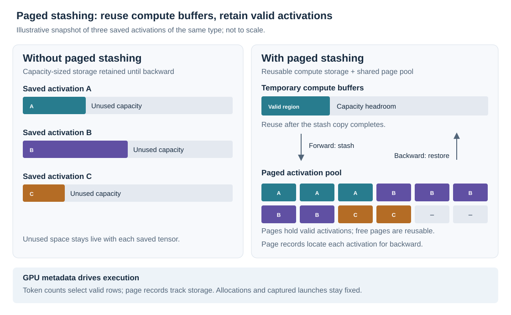

<!--
SPDX-FileCopyrightText: Copyright (c) 2026 NVIDIA CORPORATION & AFFILIATES. All rights reserved.
SPDX-License-Identifier: CC-BY-4.0
-->

# DeepSeek-V3 671B: Paged Stashing for Dropless MoE

:::{note}

NVIDIA's MLPerf Training v6.0 DeepSeek-V3 671B implementation uses full-iteration CUDA graphs for token-dropless MoE training. Device-initiated grouped GEMM and sync-free HybridEP dispatch make the expert region capturable, while paged stashing reduces the memory retained for backward.
:::

## Overview

DeepSeek-V3 is a mixture-of-experts (MoE) language model. In its routed expert layers, each token selects a subset of experts, and expert parallelism (EP) distributes those experts across GPUs. Unlike a dense feed-forward layer, the amount of work assigned to each expert changes with the input and router decisions.

Token-dropless training preserves every token's expert assignments. The resulting per-expert token counts vary between microbatches, producing dynamic tensor shapes inside an otherwise fixed-size training workload. The expert region uses GPU-resident shape metadata and preallocated buffers to support those changing workloads during graph replay.

Three components enable this execution model: **device-initiated grouped GEMM** consumes dynamic expert shapes on the GPU, **sync-free dispatch** receives tokens into capacity-sized buffers, and **paged stashing** stores saved activations compactly until backward.

## MLPerf Training DeepSeek-V3 671B Benchmark

The [NVIDIA MLPerf Training v6.0 implementation](https://github.com/mlcommons/training_results_v6.0/tree/eabf23a07b2a0c60a289ff871dc3a46fff0d0421/NVIDIA/benchmarks/deepseekv3_671b/implementations/theia_ngpu256_ngc26.04_nemo) trains the 671B model using Megatron-Bridge, Megatron-Core, PyTorch, and Transformer Engine (TE).

**Training Setup**:

- **Model**: DeepSeek-V3 671B with routed expert layers and grouped expert computation
- **Hardware configuration**: 64 GB300 nodes with four GPUs each (256 GPUs)
- **Distributed training**: TP=1, PP=4, EP=32, CP=1, with an interleaved pipeline schedule
- **Mixed precision**: MXFP8
- **Routing**: Real router decisions (`MOE_ROUTER_FORCE_LOAD_BALANCING=False`)
- **Expert execution**: HybridEP dispatch and TE fused grouped MLP operations
- **Activation storage**: Paged CUDA buffers with an optional pinned host pool

The [GB300 configuration](https://github.com/mlcommons/training_results_v6.0/blob/eabf23a07b2a0c60a289ff871dc3a46fff0d0421/NVIDIA/benchmarks/deepseekv3_671b/implementations/theia_ngpu256_ngc26.04_nemo/config_GB300_64x4x240xtp1pp4ep32cp1_mxfp8_full_cg.sh) defines this training setup. Reproduce it with the accompanying container, checkpoint preparation, data, and launcher.

**CUDA Graph Challenge**:

Even with fixed sequence length and microbatch size, different tokens choose different experts. An eager dispatcher can read the received-token count on the CPU and allocate exactly sized tensors. Replaying a CUDA graph cannot repeat that host decision: buffer addresses and kernel launch structure must remain valid as routing changes.

Fixed-capacity receive buffers remove the host allocation dependency. Dispatch and grouped expert kernels read device-resident token counts to determine valid entries, while the allocations provide headroom for routing imbalance. Each expert still processes the tokens selected by the router.

Retaining those capacity-sized buffers until backward would accumulate unused space across layers and in-flight pipeline microbatches. Paged stashing releases temporary compute storage after copying valid activations into a shared page pool, reducing the memory required to retain them.

## Integration Approach: Full-Iteration Graphing

The implementation uses Megatron's `FullCudaGraphWrapper` to capture the forward/backward schedule across microbatches. A surrounding `PagedStashRunner` handles receive-budget and stash-overflow checks before gradients reach the optimizer.

- **Implementation**: [NVIDIA DeepSeek-V3 submission](https://github.com/mlcommons/training_results_v6.0/tree/eabf23a07b2a0c60a289ff871dc3a46fff0d0421/NVIDIA/benchmarks/deepseekv3_671b/implementations/theia_ngpu256_ngc26.04_nemo)
- **Software environment**: [Submitted Dockerfile](https://github.com/mlcommons/training_results_v6.0/blob/eabf23a07b2a0c60a289ff871dc3a46fff0d0421/NVIDIA/benchmarks/deepseekv3_671b/implementations/theia_ngpu256_ngc26.04_nemo/Dockerfile), based on PyTorch NGC 26.04, Megatron-Core/Bridge `26.04-alpha.rc2`, and TE `v2.15`, with additional dependencies and build settings

### Capture Scope

**Captured in the forward/backward graph**:

- The model's forward and backward schedule across microbatches
- MoE dispatch, permutation, grouped expert computation, and combine
- Device-side stash/restore kernels and their stream dependencies

**Outside that graph**:

- Data loading and preparation of microbatch inputs
- Host-side overflow decisions and coordination of eager retries
- The optimizer update, which the submission graphs separately through `OPTIMIZER_CG=True`

The **full-iteration graph** covers the forward/backward schedule. The training loop supplies inputs before replay, checks overflow status afterward, and then runs the separately graphed optimizer update.

### Wrapper Integration and Warmup

The [Megatron training integration](https://github.com/NVIDIA/Megatron-LM/blob/6e7e6ed435e41af04fc41e7007ef862049153fdc/megatron/training/training.py) wraps the forward/backward schedule with `FullCudaGraphWrapper`, then places `PagedStashRunner` around that wrapper whenever an expert-rank capacity factor is configured. The outer runner prepares the microbatches and checks for overflow after the inner wrapper finishes warmup, capture, or replay. The training loop updates the optimizer only after the runner returns a successful result.

Warmup exercises the intended microbatch and pipeline schedule before graph capture. The submitted recipe sets `CUDA_GRAPH_WARMUP_STEPS=2`; schedule recording and stash buffer preparation must complete before steady-state replay.

### Configuration and Setup

The GB300 recipe enables full-iteration graphing and paged stashing with the following settings:

| Purpose | Submission setting | Value |
|---------|--------------------|-------|
| Full forward/backward graph | `CUDA_GRAPH_IMPLEMENTATION` / `CUDA_GRAPH_SCOPE` | `local` / `full_iteration` |
| Graph warmup | `CUDA_GRAPH_WARMUP_STEPS` | `2` |
| Dispatcher | `MOE_TOKEN_DISPATCHER_TYPE` / `MOE_FLEX_DISPATCHER_BACKEND` | `flex` / `hybridep` |
| Fused grouped expert path | `USE_TE_OPS` | `True` |
| CuTe DSL fused grouped MLP | `NVTE_CUTEDSL_FUSED_GROUPED_MLP` | `1` |
| Enable stashing | `MOE_PAGED_STASH` | `True` |
| Static receive headroom | `MOE_EXPERT_RANK_CAPACITY_FACTOR` | `4` |
| CUDA stash headroom | `MOE_PAGED_STASH_BUFFER_SIZE_FACTOR_CUDA` | `1.5` |
| Enable pinned host spill | `MOE_PAGED_STASH_BUFFER_SIZE_FACTOR_CPU` | `1` |
| Separate optimizer graph | `OPTIMIZER_CG` | `True` |

The launcher reads these environment variables through the [model YAML](https://github.com/mlcommons/training_results_v6.0/blob/eabf23a07b2a0c60a289ff871dc3a46fff0d0421/NVIDIA/benchmarks/deepseekv3_671b/implementations/theia_ngpu256_ngc26.04_nemo/conf/model/671b.yaml) and [pretrain.py](https://github.com/mlcommons/training_results_v6.0/blob/eabf23a07b2a0c60a289ff871dc3a46fff0d0421/NVIDIA/benchmarks/deepseekv3_671b/implementations/theia_ngpu256_ngc26.04_nemo/pretrain.py) and maps them into Megatron configuration.

For reproduction, follow the submission [README](https://github.com/mlcommons/training_results_v6.0/blob/eabf23a07b2a0c60a289ff871dc3a46fff0d0421/NVIDIA/benchmarks/deepseekv3_671b/implementations/theia_ngpu256_ngc26.04_nemo/README.md) to build its container, prepare the data, convert the checkpoint, and set the mount paths. From the implementation directory, after that setup:

```bash
source config_GB300_64x4x240xtp1pp4ep32cp1_mxfp8_full_cg.sh
# CONT, DATADIR, LOGDIR and checkpoint paths must match your setup.
# Add the account/partition arguments required by your Slurm cluster.
sbatch -N "${DGXNNODES}" --time="${WALLTIME}" run.sub
```

Build the training environment with the [Dockerfile](https://github.com/mlcommons/training_results_v6.0/blob/eabf23a07b2a0c60a289ff871dc3a46fff0d0421/NVIDIA/benchmarks/deepseekv3_671b/implementations/theia_ngpu256_ngc26.04_nemo/Dockerfile), which pins the Megatron/Bridge revisions and installs the TE fused grouped MLP dependencies.

:::{note} Compatibility with the newer Megatron CLI

Paged stashing is experimental. At Megatron revision [`6e7e6ed`](https://github.com/NVIDIA/Megatron-LM/tree/6e7e6ed435e41af04fc41e7007ef862049153fdc), the CLI uses `--cuda-graph-impl full_iteration` in place of the submission's older `local` plus `full_iteration` scope pair.

Start from a working MoE training command with compatible HybridEP, TE fused grouped experts, and graph-capable communication installed. Keep its model, tokenizer, data, precision, distributed topology, and optimizer arguments. Add this configuration fragment to that command:

```bash
# Configuration fragment: append to your existing Megatron MoE launch.
# Values illustrate headroom; profile your own routing and activation lifetimes.
--moe-token-dispatcher-type flex \
--moe-flex-dispatcher-backend hybridep \
--moe-grouped-gemm \
--use-transformer-engine-op-fuser \
--moe-expert-rank-capacity-factor 4.0 \
--moe-paged-stash \
--moe-paged-stash-page-size 64 \
--moe-paged-stash-buffer-size-factor-cuda 1.5 \
--moe-paged-stash-buffer-size-factor-cpu 0.0 \
--cuda-graph-impl full_iteration \
--cuda-graph-warmup-steps 2
```

This fragment uses GPU-only stashing (`--moe-paged-stash-buffer-size-factor-cpu 0.0`). The GB300 submission enables host spill with a factor of `1.0`; use `--moe-paged-stash-buffer-size-factor-cpu 1.0` to match that setting. Retain the full launch's model, data, and distributed-resource configuration.

Configuration requirements:

- Omit `--cuda-graph-modules`; full-iteration capture does not select individual modules.
- Keep `moe_expert_capacity_factor` and `moe_pad_expert_input_to_capacity` unset for dropless routing. They are different controls from the **expert-rank** receive budget used here.
- Do not combine paged stashing with `--cpu-offloading`, or with `offload_modules` containing `expert_fc1`, `moe_act`, or `fused_group_mlp`.
- Use the Megatron training integration that installs `PagedStashRunner` outside the full graph wrapper. A custom loop must implement equivalent recovery before optimizer updates.

For the complete option reference, use the [Megatron paged stash guide](https://github.com/NVIDIA/Megatron-LM/blob/6e7e6ed435e41af04fc41e7007ef862049153fdc/docs/user-guide/features/paged_stash.md). The [training integration](https://github.com/NVIDIA/Megatron-LM/blob/6e7e6ed435e41af04fc41e7007ef862049153fdc/megatron/training/training.py) installs the wrappers in the required order.
:::

## Essential Modifications for CUDA Graph Compatibility

### 1. Device-Initiated Grouped GEMM

Traditional host-initiated grouped GEMM needs CPU-side per-expert token counts to choose GEMM shapes and launches. Grouping the GEMMs improves execution efficiency, but that shape query still blocks CUDA graph capture.

Device-initiated grouped GEMM reads shapes directly from device memory. Its static launch configuration supports a changing amount of runtime work and skips unused capacity. TE provides two implementations ([Megatron Core paper, section 4.3.7](https://arxiv.org/html/2603.07685v1#S4.SS3.SSS7)):

- **cuBLASLt grouped GEMM**, accepting device arrays of matrix shapes starting with CUDA 13.1.
- **CuTe DSL grouped GEMM**, supporting fused SwiGLU and, for supported FP8 configurations, fused quantization. Precision and fusion coverage depend on the implementation.

The captured GEMM launch reads updated shape metadata on each replay. “Device-initiated” describes this device-side handling of the workload; the host still launches the captured graph. Sync-free dispatch supplies the token buffers and counts, and paged stashing retains the activations needed for backward.

**Shape metadata through the expert MLP**

The [expert MLP](https://github.com/NVIDIA/Megatron-LM/blob/6e7e6ed435e41af04fc41e7007ef862049153fdc/megatron/core/transformer/moe/experts.py) passes a GPU `tokens_per_expert` tensor to both grouped linear operations through the TE operation-fuser path. The paged stash context receives the device-side sum of these counts to determine the activation region to save.

For example, a replay can change token counts from `[96, 160]` to `[144, 112]` without changing the capacity-sized allocation. The grouped operations consume the updated segment lengths. Keeping those counts as a GPU tensor removes the device-to-host synchronization between dispatch and GEMM.

`--moe-grouped-gemm` selects grouped experts and `--use-transformer-engine-op-fuser` selects the TE operation path that consumes device counts. TE selects a kernel supported by the build, precision, and fusion configuration. The GB300 recipe enables the CuTe DSL fused grouped MLP with `NVTE_CUTEDSL_FUSED_GROUPED_MLP=1` and the operation-fuser path with `USE_TE_OPS=True`.

### 2. Sync-Free Dispatch with Static Receive Buffers

The GB300 recipe selects `MOE_TOKEN_DISPATCHER_TYPE=flex`, `MOE_FLEX_DISPATCHER_BACKEND=hybridep`, and `MOE_EXPERT_RANK_CAPACITY_FACTOR=4`. HybridEP uses the configured rank budget to pre-size receive and permute buffers, keeping the received-token count on the GPU during the captured schedule.

Device-initiated grouped GEMM removes the host query for expert computation; sync-free dispatch removes the corresponding query for communication output sizing. GPU-resident metadata connects dispatch, expert computation, and combine throughout graph replay.

The rank capacity factor sizes receive buffers relative to balanced routing. When routing exceeds this budget, `PagedStashRunner` reruns the step without the static limit to preserve dropless training semantics.

### 3. Paged Stashing for Saved Activations



*Figure: Paged stashing compacts the activations retained for backward while preserving static compute capacity. Colors identify saved activations; gray denotes unused capacity or free pages. Temporary buffers may be double-buffered to overlap copies with computation; the diagram groups those buffers for clarity.*

Paged stashing separates temporary expert compute storage from the saved activations retained until backward. Each activation moves through four stages:

1. **Compute with static capacity and device metadata.** HybridEP dispatch uses pre-sized buffers; TE device-initiated grouped experts consume GPU token counts. The compute kernels determine valid work from device metadata.
2. **Stash after forward.** GPU kernels obtain pages from a free list and copy the valid activation region into the pool. Each saved activation retains page records describing its storage.
3. **Release temporary storage after the copy completes.** Later layers and microbatches reuse the temporary storage while the saved activation remains in the page pool.
4. **Restore before backward.** GPU kernels reconstruct the activation in the buffer expected by expert backward and return its pages for reuse.

The preallocated pool uses fixed-size pages managed by GPU kernels. Page ownership and valid lengths change during replay without per-activation host allocation. Saved activations occupy pages according to their valid token counts, with additional space for page rounding and pool headroom. Page records locate each activation for restore.

The [paged stashing design in Megatron-LM PR #2690](https://github.com/NVIDIA/Megatron-LM/pull/2690) and the [paged stash implementation](https://github.com/NVIDIA/Megatron-LM/blob/6e7e6ed435e41af04fc41e7007ef862049153fdc/megatron/core/transformer/moe/paged_stash.py) describe the page manager and its scheduling hooks.

### 4. Pipeline Scheduling and Stream Dependencies

The page manager supports the activation lifetimes of interleaved pipeline schedules. Megatron records execution order during warmup, then uses pre/post scheduling autograd functions to arrange stash and restore work around expert computation. Stream dependencies ensure a stash finishes before its source storage is reused and a restore finishes before backward reads it. Warmup must exercise the intended pipeline and microbatch schedule before capture.

### 5. Overflow Recovery Before the Optimizer Update

The static execution path detects two overflow conditions: received tokens exceeding the rank budget and saved activations exceeding the available stash pages. HybridEP can drop over-budget tokens during the failed attempt, so the runner discards its gradients and retries before the optimizer update.

Megatron's `PagedStashRunner` checks receive-budget and stash-overflow status across ranks after forward/backward. On success, it returns the result to the training loop. On failure, it clears gradients, invalidates the affected graph, disables fixed-capacity dispatch and paged stashing, and reruns the same microbatches eagerly in dropless mode. The optimizer receives gradients from the successful attempt.

The retry reuses the prefetched microbatches with the static receive limit and paged stashing disabled. After it succeeds, the runner restores the configured capacity and stash settings for subsequent steps. Resetting the graph also resets its warmup counter. The retry advances that counter, and execution remains eager until the configured warmup count is reached and the wrapper captures a new graph. Recovery therefore includes the retry, any remaining eager warmup steps, and graph recapture.

This recovery preserves dropless training semantics across routing spikes. Overflow checks run on the host after forward/backward; the per-layer dispatch, expert computation, and stash/restore operations remain sync-free inside the graph.

### 6. Buffer Sizing and Optional Host Spill

Receive capacity, stash pool capacity, and page size control different resources:

| Control | What it sizes | Symptom when too small |
|---------|---------------|------------------------|
| `moe_expert_rank_capacity_factor` | Per-rank dispatch/expert capacity relative to balanced routing | Receive over-budget and a dropless eager rerun |
| `moe_paged_stash_buffer_size_factor_cuda` | CUDA pool for simultaneously live saved activations | Stash overflow, or host spill if enabled |
| `moe_paged_stash_buffer_size_factor_cpu` | Optional pinned host stash pool; `0` disables it | Overflow if neither pool can hold an activation |
| `moe_paged_stash_page_size` | Token rows per page | Tradeoff between page rounding waste and page-management overhead |

Positive stash factors scale a balanced-token reference accumulated over activation lifetimes in the recorded schedule. The receive factor controls transient per-rank token peaks, while stash factors control simultaneously live saved activations. Tune these factors independently to match the routing distribution and pipeline schedule.

Profile representative routing, including training transitions and imbalance spikes. Increase receive headroom when over-budget events recur. Increase CUDA pool headroom when stash overflow or frequent host spill dominates. Changing pipeline depth, virtual stages, microbatch count, precision, or recomputation changes the live activation set and requires fresh measurement.

A positive CPU factor enables a pinned host pool. When the CUDA pool lacks enough pages for an activation, the stash kernel can place it in the host pool and restore it for backward. Host spill reduces pressure on the CUDA pool and avoids overflow retries when host capacity is available, at the cost of host memory and interconnect traffic.

## Performance Impact

Full-iteration graph replay reduces host launch overhead, device-initiated kernels remove per-layer shape queries, and paged stashing reduces the memory retained for backward:

| Technique | Benefit | Cost or constraint |
|-----------|------------------|--------------------|
| Full forward/backward replay | Reduces repeated host launch overhead | Warmup/capture cost and fixed execution schedule |
| Device-initiated expert kernels and sync-free dispatch | Removes per-layer host shape queries | Compatible kernels and preallocated capacity |
| Paged stashing | Reduces unused capacity retained for backward | Stash/restore copies, page metadata, and temporary buffers |
| Optional host spill | Relieves pressure on the CUDA stash pool | Pinned host memory and interconnect traffic |

Paged stashing retains only valid activations in the page pool and allows capacity-sized temporary buffers to be reused across layers. This avoids retaining unused capacity for every layer and in-flight microbatch awaiting backward.

Stash and restore copies share a dedicated CUDA side stream so they can overlap with expert computation. These copies consume memory bandwidth, while page records, pool headroom, and temporary buffers contribute to the memory footprint. Buffer sizing and scheduling control the balance between memory savings, copy overlap, and overflow recovery.

### DeepSeek-V3 on 256 GB300 GPUs

For DeepSeek-V3 671B training on 256 NVIDIA GB300 GPUs, full CUDA graph execution with paged stashing delivers a **1.68× training speedup** over execution without CUDA graphs. GPU memory usage decreases from **221 GB to 209 GB**, a reduction of **12 GB (5.4%)**.

| Configuration | Training speedup | GPU memory (GB) |
|---------------|------------------|-----------------|
| No CUDA graph | 1.00× (baseline) | 221 |
| Full CUDA graph + paged stashing | 1.68× | 209 |

### Performance Monitoring

Monitor iteration time, peak allocated and reserved GPU memory, host memory use, and spill and overflow-retry frequency. A CUDA trace shows graph coverage, copy/compute overlap, and recapture after recovery. Measure steady-state replay after initialization and capture, and include retries, remaining eager warmup steps, and recapture in end-to-end throughput. These metrics guide receive-budget and stash-pool sizing for the training schedule.

## Key Lessons

1. **Device-initiated grouped GEMM removes host shape queries.** Expert kernels read GPU token counts to handle changing workloads through reusable captured launches.
2. **Dispatch and compute must both be sync-free.** Static receive buffers enable HybridEP to feed changing expert workloads into the captured grouped MLP.
3. **Compute capacity and saved-activation storage have different lifetimes.** Paged stashing packs valid activations for backward so each pending layer and microbatch does not retain its entire capacity-sized buffer.
4. **Recovery preserves dropless behavior.** The runner discards gradients from overflowed attempts and reruns the same microbatches without the static capacity limit before the optimizer updates.
5. **Tune for the actual schedule and routing.** Receive headroom, live activation peaks, spill traffic, and rerun frequency jointly determine the memory/performance tradeoff.

## References

**MLPerf Training Resources**:

- [NVIDIA DeepSeek-V3 v6.0 implementation](https://github.com/mlcommons/training_results_v6.0/tree/eabf23a07b2a0c60a289ff871dc3a46fff0d0421/NVIDIA/benchmarks/deepseekv3_671b/implementations/theia_ngpu256_ngc26.04_nemo) - Submitted configuration, launcher, and environment
- [Submission README](https://github.com/mlcommons/training_results_v6.0/blob/eabf23a07b2a0c60a289ff871dc3a46fff0d0421/NVIDIA/benchmarks/deepseekv3_671b/implementations/theia_ngpu256_ngc26.04_nemo/README.md) - Container, data, checkpoint, and launch instructions

**Design and Implementation**:

- [Megatron Core paper, section 4.3.7](https://arxiv.org/html/2603.07685v1#S4.SS3.SSS7): device-initiated kernels and paged stashing.
- [Megatron-LM PR #2690](https://github.com/NVIDIA/Megatron-LM/pull/2690): paged stashing design and pipeline scheduling.
- [GPU stash/restore kernels](https://github.com/NVIDIA/Megatron-LM/blob/6e7e6ed435e41af04fc41e7007ef862049153fdc/megatron/core/transformer/moe/ops/paged_stash.py): page allocation, copies, overflow, and host spill.

## What's Next?

**Explore more CUDA graph examples**:

- **[Llama 3.1 405B](llama-31-405b.md)** - Full-iteration graphing for a dense transformer
- **[GPT-3 175B](gpt-3-175b.md)** - Per-layer graphing with pipeline parallelism and FP8

**Continue learning**:

- **[Writing Sync-Free Code](../torch-cuda-graph/sync-free-code.md)** - Keep shape metadata and execution decisions on the GPU
- **[Memory Issues](../troubleshooting/memory-issues.md)** - Diagnose graph memory pools, fragmentation, and buffer lifetimes
- **[Partial Graphing for Dropless MoE](../torch-cuda-graph/handling-dynamic-patterns.md#example-2-moe-models-with-token-dropless)** - Graph surrounding static layers when the expert implementation requires host-side sizing
- **[Transformer Engine and Megatron-LM CUDA Graphs](../torch-cuda-graph/te-megatron-cuda-graphs.md)** - Framework capture and replay infrastructure
- **[Troubleshooting](../troubleshooting/introduction.md)** - Debug capture failures, memory issues, and numerical errors
