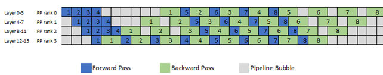

<!--
SPDX-FileCopyrightText: Copyright (c) 2026 NVIDIA CORPORATION & AFFILIATES. All rights reserved.
SPDX-License-Identifier: CC-BY-4.0
-->

# GPT-3 175B

:::{note}

CUDA Graph optimization for GPT-3 175B training, based on NVIDIA's MLPerf Training v4.1 (2024/11) implementation. This example demonstrates per-layer graphing with Transformer Engine's `make_graphed_callables` for large-scale transformer training with pipeline parallelism.
:::

## Overview

GPT-3 (Generative Pre-trained Transformer 3) is OpenAI's large language model released in 2020, representing a significant milestone in scaling transformer-based language models. The 175-billion-parameter version (GPT-3 175B) demonstrated that language models could achieve strong few-shot learning capabilities through scale alone, without task-specific fine-tuning.

The model follows the standard decoder-only transformer architecture with several key characteristics:

- **Model size**: 175 billion parameters across 96 transformer layers
- **Architecture**: Dense decoder-only transformer with 12,288 hidden dimensions, 96 attention heads
- **Context window**: 2,048 tokens
- **Training objective**: Next-token prediction with cross-entropy loss
- **Parameter distribution**:
    - Embedding layer: ~25B parameters (vocabulary size 50,257)
    - 96 Transformer blocks: ~150B parameters (attention + MLP)
    - Output layer: Tied with embedding weights

Training such a massive model requires advanced distributed training techniques including tensor parallelism (TP), pipeline parallelism (PP), and data parallelism (DP) to partition the model across hundreds or thousands of GPUs.

## MLPerf Training GPT-3 175B Benchmark

MLCommons introduced GPT-3 175B into the MLPerf Training v3.0 benchmark suite in June 2023, providing a standardized benchmark for large language model training. The model remained in the benchmark through v4.1 (November 2024) before being retired in v5.0 (May 2025) and replaced with Llama 3.1 405B to reflect more modern architectures.

**Dataset and Task**:

The benchmark uses the **C4 (Colossal Clean Crawled Corpus)** dataset from AllenAI, comprising English-language paragraphs extracted from web crawl data. Training starts from a pre-trained checkpoint that has been trained with a global batch size of 1,536 for 4,000 iterations, ensuring stability before the timed benchmark region begins.

**Reference Implementation**:

The MLPerf reference implementation is built on **Megatron-LM**, NVIDIA's framework for training large transformer models. The implementation uses **Megatron-LM + PyTorch + Transformer Engine** as the software stack and has been tested on NVIDIA A100, H100, and B200 GPUs.

Training employs 3D parallelism combining tensor parallelism (TP), pipeline parallelism (PP), and data parallelism (DP). Training uses BF16 mixed precision with FP8 (Transformer Engine) for compute-intensive operations, gradient accumulation across multiple microbatches, interleaved pipeline parallelism with 8 virtual stages, and fixed-size sequences (2,048 tokens).

**Quality Metric**:

The benchmark measures **log perplexity on the C4 validation set**, with a target of ≤ 2.69. This metric evaluates how well the model predicts the next token in sequences, with lower perplexity indicating better language understanding.

For complete model architecture details, dataset preparation, and optimizer configuration, see the [MLPerf Training GPT-3 reference](https://github.com/mlcommons/training/blob/95f90e857ade5392f83f54393cdccb55d12ac67f/retired_benchmarks/gpt3/megatron-lm/README.md).

**CUDA Graph Challenge**:

Applying CUDA graphs to GPT-3 175B training presents several challenges:

1. **Pipeline parallelism complexity**: PP ranks execute interleaved microbatch schedules, requiring per-layer graphs to handle complex execution ordering across multiple microbatches and pipeline stages
2. **Memory management**: Creating separate graphs for each layer and each microbatch (96 layers × 8 microbatches × 2 (fwd+bwd) = 1,536 graphs per GPU) requires careful memory pool management
3. **FP8 state coordination**: FP8 training maintains global scaling state that must be synchronized across all graphed layers
4. **Graph replay ordering**: Graphs sharing memory pools must replay in the exact capture order to avoid memory corruption

Despite these challenges, NVIDIA's MLPerf Training v4.1 implementations successfully use Transformer Engine's `make_graphed_callables` to capture per-layer computation, achieving significant performance improvements at scale.

## Integration Approach: Per-Layer Graphing

This section describes how the MLPerf v4.1 implementation uses per-layer CUDA graphs with `make_graphed_callables`.

- **Implementation**: [training_results_v4.1/NVIDIA/.../eos-dfw_n1452_ngc24.04_nemo](https://github.com/mlcommons/training_results_v4.1/tree/main/NVIDIA/benchmarks/gpt3/implementations/eos-dfw_n1452_ngc24.04_nemo)
- **Framework versions**: PyTorch NGC 24.09, NeMo 24.09-alpha.rc0, Megatron-LM 24.09-alpha.rc0, Transformer Engine v1.10

### Capture Scope (Per-Layer Graphing)

The v4.1 implementation uses **per-layer graphing**, capturing each transformer layer as a separate CUDA graph for each microbatch. This approach provides fine-grained control over individual layer execution but requires careful management of graph memory pools and replay ordering.

**Captured in graphs**:

- **Individual transformer layers**: Each of the 96 decoder layers is captured separately
- **Layer components**: Self-attention (QKV projection, attention computation, output projection) and MLP (FFN with SiLU activation)
- **Gradient computation**: Backward passes for each layer are also captured separately
- **FP8 operations**: When FP8 is enabled, quantization and dequantization are included in graphs. Weight caching is enabled (`fp8_weight_caching=True`) to reuse FP8-quantized weights across microbatches—weights are quantized only on the first microbatch, then cached for subsequent microbatches

**Remaining in eager mode**:

- Embedding layer (input and output projection)
- Layer normalization (initial and final)
- Pipeline parallel communication (send/recv between PP ranks)
- Data parallel gradient all-reduce
- Optimizer step (distributed fused Adam)
- Loss computation
- Learning rate scheduling
- Gradient clipping

**Why per-layer graphing?**

Per-layer graphing enables partial CUDA graph adoption that fits GPT-3's training characteristics:

- **Selective graphing**: Only compute-intensive transformer layers are graphed, while embeddings, pipeline communication, and optimizer remain in eager mode
- **Incremental deployment**: Individual layer graphs can be enabled/disabled independently, facilitating debugging and gradual rollout

**Scale**: CUDA graphs deployed across multiple GPU configurations:

- **A100 (DGX A100)**: 128 nodes (1,024 GPUs) - no CUDA graph configs in v4.1 submission
- **H100 (DGX H100)**: 24-1,452 nodes (192-11,616 GPUs) with CUDA graph support

**Configuration examples** (from [MLPerf Training v4.1 submissions](https://github.com/mlcommons/training_results_v4.1/tree/main/NVIDIA/benchmarks/gpt3/implementations)):

- **H100 1,452 nodes (11,616 GPUs)**: TP=4, PP=6, MINIBS=6, micro-batch size=1, with CUDA graph
- **B200 8 nodes (64 GPUs)**: TP=4, PP=8, MINIBS=1024, micro-batch size=2, with CUDA graph

Multiple CUDA graphs are created per layer: one for each microbatch that the layer processes during a training iteration.

### Configuration and Setup

The implementation uses Transformer Engine's `make_graphed_callables` API to capture individual transformer layers as CUDA graphs before training begins. During training, these pre-captured graphs are replayed by Megatron-LM's infrastructure to execute the forward and backward passes for each layer.

**Configuration** ([custom.yaml](https://github.com/mlcommons/training_results_v4.1/tree/main/NVIDIA/benchmarks/gpt3/implementations/eos-dfw_n1452_ngc24.04_nemo/conf/custom.yaml)):

```yaml
model:
  enable_cuda_graph: ${oc.decode:${oc.env:LAYER_CUDA_GRAPH,False}}
```

Set via environment variable ([config_DGXH100_1452x8x6x4x6_mbs1_cg.sh](https://github.com/mlcommons/training_results_v4.1/tree/main/NVIDIA/benchmarks/gpt3/implementations/eos-dfw_n1452_ngc24.04_nemo/config_DGXH100_1452x8x6x4x6_mbs1_cg.sh)):

```bash
export LAYER_CUDA_GRAPH=1
```

When `enable_cuda_graph=True` is set, Megatron-LM's `TransformerBlock` initializes an empty `cuda_graphs` dictionary ([transformer_block.py#L143](https://github.com/NVIDIA/Megatron-LM/blob/24.09-alpha.rc0/megatron/core/transformer/transformer_block.py#L143)):

```python
# Item `i` in the dictionary is a list of `N` CUDA graphs for layer 'i' where N is the
# number of microbatches. Multiple CUDA graphs per layer is required to support
# pipelining which requires running FWD graph of multiple microbatches before BWD graph.
self.cuda_graphs = {}
self.current_microbatch = -1
```

This dictionary is populated by user code using `make_graphed_callables` before training begins.

### Graph Capture with Transformer Engine's `make_graphed_callables`

The MLPerf implementation uses a custom callback to capture all layers with Transformer Engine's `make_graphed_callables` before training begins ([custom_callbacks.py#L170-L292](https://github.com/mlcommons/training_results_v4.1/tree/main/NVIDIA/benchmarks/gpt3/implementations/eos-dfw_n1452_ngc24.04_nemo/custom_callbacks.py#L170-L292)). For detailed documentation on `make_graphed_callables`, see [Transformer Engine and Megatron-LM CUDA Graphs](../torch-cuda-graph/te-megatron-cuda-graphs.md#transformer-engine-make_graphed_callables).

**Step 1: Determine pipeline schedule**

First, calculate the microbatch execution schedule based on the pipeline parallelism configuration:

```python
def get_microbatch_schedule(num_microbatches, pipeline_parallel_size, num_model_chunks=None):
    """Generate pipeline schedule: list of chunk IDs (positive=forward, negative=backward)"""
    if pipeline_parallel_size > 1:
        if num_model_chunks is not None and num_model_chunks > 1:
            # Interleaved pipeline schedule (virtual pipeline parallelism)
            # Complex schedule with model chunk interleaving - see full implementation
            pass  # Simplified for illustration
        else:
            # Pipeline parallelism without virtual pipeline (1F1B schedule)
            num_warmup_microbatches = pipeline_parallel_size - 1  # Varies by rank
            num_warmup_microbatches = min(num_warmup_microbatches, num_microbatches)
            num_microbatches_remaining = num_microbatches - num_warmup_microbatches
            schedule = [1]*num_warmup_microbatches + [1,-1]*num_microbatches_remaining + [-1]*num_warmup_microbatches
    else:
        # No pipeline parallelism - forward+backward per microbatch
        schedule = [1, -1] * num_microbatches
    return schedule
```

The schedule is a list where positive integers represent forward passes and negative integers represent backward passes. For pipeline parallelism without virtual pipeline (PP > 1, single model chunk), the schedule follows a 1F1B pattern with three phases: (1) **warmup** - run several forward passes to fill the pipeline (number depends on pipeline rank), (2) **steady-state 1F1B** - alternate forward-backward pairs, and (3) **cooldown** - drain remaining backwards. For no pipeline parallelism (PP = 1), each microbatch runs forward then backward before proceeding to the next microbatch.

**Step 2: Prepare sample inputs**

Create sample tensors matching the layer input shapes:

```python
# Get model configuration
device = model.decoder.layers[0].layernorm_mlp.fc1_weight.device
sequence_parallel = cfg.sequence_parallel
tensor_model_parallel_size = cfg.tensor_model_parallel_size
micro_batch_size = cfg.micro_batch_size
slen = cfg.encoder_seq_length // tensor_model_parallel_size if sequence_parallel else cfg.encoder_seq_length

# Create sample inputs for each layer and microbatch
sample_args = []
for layer in model.module.decoder.layers:
    graph_input = (torch.ones((slen, micro_batch_size, cfg.hidden_size),
                              dtype=torch.bfloat16, requires_grad=True, device=device),)
    sample_args.append(graph_input)
```

**Step 3: Configure FP8 recipe**

When FP8 training is enabled, configure the FP8 scaling recipe:

```python
if cfg.fp8_e4m3:
    fp8_format = recipe.Format.E4M3
elif cfg.fp8_hybrid:
    fp8_format = recipe.Format.HYBRID
else:
    raise ValueError("E4M3 and HYBRID are the only supported FP8 formats.")

fp8_recipe = recipe.DelayedScaling(
    margin=cfg.fp8_margin,
    interval=cfg.fp8_interval,
    fp8_format=fp8_format,
    amax_compute_algo=cfg.fp8_amax_compute_algo,
    amax_history_len=cfg.fp8_amax_history_len,
    override_linear_precision=(False, False, False),
)
```

**Step 4: Capture graphs with make_graphed_callables**

Call `make_graphed_callables` to capture all layers:

```python
from transformer_engine.pytorch.graph import make_graphed_callables

callables = [layer for layer in model.module.decoder.layers]  # All 96 layers

graphs = make_graphed_callables(
    tuple(callables),                # All layers to graph
    tuple(sample_args),             # Sample inputs (one per layer per microbatch)
    _order=schedule,                # Pipeline schedule
    allow_unused_input=True,        # Some inputs may be unused
    fp8_enabled=cfg.fp8,           # Enable FP8
    fp8_recipe=fp8_recipe if cfg.fp8 else None,
    fp8_weight_caching=True,       # Cache FP8 weight quantization across microbatches
    num_warmup_iters=3,            # Warmup iterations before capture
)
```

**Step 5: Populate cuda_graphs dictionary**

Store the captured graphs in Megatron's `cuda_graphs` dictionary:

```python
for l_no, layer in enumerate(model.module.decoder.layers):
    model.module.decoder.cuda_graphs[l_no] = []
    for b in range(num_microbatches):
        # graphs is a flat list: [layer0_mb0, layer1_mb0, ..., layer95_mb0, layer0_mb1, ...]
        model.module.decoder.cuda_graphs[l_no].append(
            graphs[b * len(model.module.decoder.layers) + l_no]
        )
```

After capture, each layer has a list of graphs (one per microbatch): `cuda_graphs[layer_id][microbatch_id]`.

### Graph Replay During Training

During the training loop, Megatron-LM's `TransformerBlock.forward()` automatically replays the appropriate graph for each layer and microbatch ([transformer_block.py#L432-L468](https://github.com/NVIDIA/Megatron-LM/blob/24.09-alpha.rc0/megatron/core/transformer/transformer_block.py#L432-L468)):

```python
for l_no, layer in enumerate(self.layers):
    if (len(self.cuda_graphs) == 0) or (not self.training):
        # Eager mode: no graphs or validation
        hidden_states, context = layer(
            hidden_states=hidden_states,
            attention_mask=attention_mask,
            context=context,
            context_mask=context_mask,
            rotary_pos_emb=rotary_pos_emb,
            inference_params=inference_params,
            packed_seq_params=packed_seq_params,
        )
    else:
        # Graph replay mode
        cg_index = self.current_microbatch % len(self.cuda_graphs[l_no])
        optional_inputs = self.get_cuda_graph_optional_args(
            attention_mask, context, context_mask, rotary_pos_emb,
            inference_params, packed_seq_params
        )
        hidden_states = self.cuda_graphs[l_no][cg_index](
            hidden_states, **optional_inputs
        )
```

**Key mechanism**:

- `self.current_microbatch` is updated by the pipeline schedule to track which microbatch is currently executing
- For each layer, the appropriate graph is selected using `cg_index = self.current_microbatch % len(self.cuda_graphs[l_no])`
- The graph is replayed with the current `hidden_states` as input
- Optional inputs (attention masks, rotary embeddings) are passed as keyword arguments (supported in TE v1.10+)

Megatron's infrastructure automatically handles graph replay once the graphs are captured and populated into the `cuda_graphs` dictionary.

## Essential Modifications for CUDA Graph Compatibility

This section covers the essential changes required to make per-layer CUDA graphs work correctly with GPT-3 175B training using `make_graphed_callables`.

### 1. Eliminating CPU-GPU Synchronizations

**Problem**: CPU-GPU synchronizations (`.item()`, `torch.cuda.synchronize()`) are forbidden during CUDA graph capture and significantly harm performance during replay.

**Solution**: The MLPerf GPT-3 implementation removes CPU-GPU synchronizations from the graphed region. Since per-layer graphing captures only transformer layer forward and backward passes, the implementation ensures these layers contain no `.item()` calls, explicit `torch.cuda.synchronize()`, or other operations that would cause CPU-GPU synchronization. Features that require synchronization—such as NaN checking in loss functions—are disabled for CUDA graph runs.

The per-layer graphing approach naturally helps with sync removal because it captures a narrow scope (individual layers) while leaving operations like optimizer steps, gradient clipping, and logging in eager mode outside the graphs. This makes it easier to identify and eliminate synchronizations within the graphed region compared to full-iteration graphing, where a much larger portion of the training loop must be made sync-free.

For general guidance on eliminating synchronizations for CUDA graphs, see [Writing Sync-Free Code](../torch-cuda-graph/sync-free-code.md).

### 2. Global FP8 Buffer

**Problem**: FP8 training maintains global buffers to store FP8 metadata (amax history, scale, scale_inv) and transposed FP8 weights across all layers. These global buffers are **CUDA graph inputs**—they are accessed by operations inside the captured graph. Before [PR #575](https://github.com/NVIDIA/TransformerEngine/pull/575), these buffers were dynamically constructed and deleted during training, which is fundamentally incompatible with CUDA graphs.

**Why this matters**: CUDA graph inputs must have static, persistent memory addresses. Dynamic buffer allocation/deallocation changes memory addresses across iterations, causing the graph to access invalid or stale memory during replay.

**Before PR #575: Dynamic Buffer Management ❌**

The old implementation used a single `global_fp8_buffer` dictionary that was **built and destroyed** dynamically:

**Build phase** (in each module's forward):
```python
# Old: add_amax_to_global_buffer() - dynamically appends to buffer
def add_amax_to_global_buffer(cls, fp8_meta, forward=True):
    buffer_key = cls.get_amax_buffer_key(fp8_meta, forward=forward)

    if buffer_key not in cls.global_fp8_buffer:
        cls.global_fp8_buffer[buffer_key] = [fp8_meta[...].amax_history[0]]  # Create new list
    else:
        cls.global_fp8_buffer[buffer_key].append(                           # Append to existing
            fp8_meta[...].amax_history[0]
        )
```

**Reduction phase** (concat, reduce, split back):
```python
# Old: Concat, reduce, then split back to new list (reallocates memory)
def amax_forward_global_reduce(...):
    chunk_sizes = [x.numel() for x in cls.global_fp8_buffer[amax_buffer_key]]
    contiguous_amax = torch.cat(cls.global_fp8_buffer[amax_buffer_key])

    # All-reduce across GPUs
    cls.reduce_tensor_across_group_op_max(contiguous_amax, reduce_group)

    # Split and write back - creates new list of tensors!
    cls.global_fp8_buffer[amax_buffer_key] = list(contiguous_amax.split(chunk_sizes))
    # ❌ New list allocation changes memory addresses
```

**Delete phase** (at autocast exit):
```python
# Old: delete_key_from_amax_buffer() - removes buffer entries
def delete_key_from_amax_buffer(cls, forward=True):
    if cls.buffer_delete_key_fwd in cls.global_fp8_buffer:
        del cls.global_fp8_buffer[cls.buffer_delete_key_fwd]  # ❌ Deletes entire buffer!
```

**The problem**: This pattern creates temporary lists, appends tensors during forward, and deletes them at autocast exit. On the next iteration, a new buffer is created again, resulting in **different memory addresses** each time. Since these buffers are CUDA graph inputs, the graph captures references to the old addresses. When the buffer is deleted and recreated, the graph accesses invalid memory, causing replay failures.

**After PR #575: Persistent Buffer Management ✓**

The new implementation uses **separate persistent buffers** for each FP8 metadata component that are **built once and never deleted**:

**Build phase** (in each module's first forward, or before graph capture):
```python
# New: add_fp8_tensors_to_global_buffer() - builds persistent buffers once
def add_fp8_tensors_to_global_buffer(cls, fp8_meta, fp8_weights=None):
    # Guard: Only register once per module
    index_in_buffer = cls.get_buffer_info()
    if index_in_buffer in fp8_meta:
        return  # ✓ Already registered, skip

    for forward in (True, False):
        key = cls.get_key_in_buffer(forward, ...)

        if key not in cls.global_amax_buffer:
            # Create all buffers together, persist for entire training
            cls.global_amax_buffer[key] = [fp8_meta[...].amax_history[0]]
            cls.global_amax_history_buffer[key] = [fp8_meta[...].amax_history]
            cls.global_scale_buffer[key] = [fp8_meta[...].scale]
            cls.global_scale_inv_buffer[key] = [fp8_meta[...].scale_inv]
        else:
            # Append references to existing buffers (only during initial setup)
            cls.global_amax_buffer[key].append(fp8_meta[...].amax_history[0])
            cls.global_amax_history_buffer[key].append(fp8_meta[...].amax_history)
            cls.global_scale_buffer[key].append(fp8_meta[...].scale)
            cls.global_scale_inv_buffer[key].append(fp8_meta[...].scale_inv)
```

**Update phase** (during reduction via in-place updates):
```python
# New: reduce_and_update_fp8_tensors() - updates buffers in-place
def reduce_and_update_fp8_tensors(cls, forward=True, fp8_weights=False):
    for buffer_key, amax_buffer in cls.global_amax_buffer.items():
        contiguous_amax = torch.cat(amax_buffer)  # Concat for reduction

        # All-reduce across GPUs
        if recipe.reduce_amax and torch.distributed.is_initialized():
            cls.reduce_tensor_across_group_op_max(contiguous_amax, group)

        # Update scale factors in-place using fused kernel
        tex.fused_amax_and_scale_update_after_reduction(
            contiguous_amax,
            cls.global_amax_history_buffer[buffer_key],  # ✓ In-place update
            cls.global_scale_buffer[buffer_key],          # ✓ In-place update
            cls.global_scale_inv_buffer[buffer_key],      # ✓ In-place update
            ...
        )
```

**No delete phase**: Buffers remain persistent across entire training—no `del` operations!

**Essence of the change**: The key difference is that before PR #575, buffers served as CUDA graph inputs were dynamically created and destroyed each iteration, changing memory addresses. After PR #575, buffers are allocated once and updated in-place, maintaining fixed memory addresses throughout training.

```python
# Before PR #575: Recreate tensors every iteration (changes memory addresses)
# Each iteration:
buffer[key] = [torch.empty(...), ...]           # ❌ Create new tensors outside cuda graph range
# ... use/update tensors inside cuda graph range ...
del buffer[key]                                 # ❌ Delete buffer outside cuda graph range
# Tensors are deleted but CUDA graph still references the old addresses!

# After PR #575: Create once, update in-place (fixed memory addresses)
# Setup (once):
if key not in buffer:
    buffer[key] = [torch.empty(...), ...]      # ✓ Create once
# Every iteration:
buffer[key][0].copy_(new_data)                  # ✓ In-place update
# Same tensors, same memory addresses forever
```

:::{note} Key Principle: CUDA Graph Inputs Must Be Static

**Global buffers used within CUDA graphs are CUDA graph inputs**, and all CUDA graph inputs must be static and persistent. They must:

- Be allocated **before** graph capture
- Maintain **fixed memory addresses** across all graph replays
- Be updated **in-place** (no reallocation)
- Never be deleted or assigned to new tensors before the end of CUDA graph usage

This is why PR #575 transformed the global FP8 buffers from dynamic allocation/deallocation to persistent tensors with in-place updates.
:::

**Key Differences Summary**

| Aspect | Before PR #575 (Dynamic) | After PR #575 (Persistent) |
|--------|--------------------------|----------------------------|
| **Buffer structure** | Single `global_fp8_buffer` dict | Four separate buffers: `global_amax_buffer`, `global_amax_history_buffer`, `global_scale_buffer`, `global_scale_inv_buffer` |
| **Build mechanism** | Dynamic `append()` every forward | Build once during first call, guarded by `if index_in_buffer in fp8_meta` |
| **Update mechanism** | Write new tensor references after reduction | In-place update via fused kernel |
| **Delete mechanism** | ❌ `del global_fp8_buffer[key]` at autocast exit | ✓ No deletion—buffers persist forever |
| **Memory addresses** | ❌ Change every iteration | ✓ Fixed across all iterations |
| **CUDA graph compatibility** | ❌ Incompatible (dynamic allocation) | ✓ Compatible (static persistent tensors) |
| **When to register** | Every forward pass (with append) | Once per module (first forward or before capture) |

The persistent buffer management is completely automatic after PR #575—users don't need to do anything. For CUDA graph usage, Transformer Engine ensures buffers are built before graph capture and remain valid during all graph replays.

### 3. Dynamic Scaling State

**Problem**: FP8 training maintains dynamic scaling state (amax history, scale factors) that must be reduced across GPUs and updated once per iteration. In standard eager execution, Transformer Engine calls `reduce_and_update_fp8_tensors()` at the exit of each `fp8_autocast` context to perform an all-reduce of amax values and update scaling factors. However, with per-layer per-microbatch graphing, each layer wraps its forward/backward in separate `fp8_autocast` contexts. If `reduce_and_update_fp8_tensors()` is captured inside each graph, it would execute during every layer's graph replay, causing incorrect scaling and redundant communication.

**Why this matters**: With per-layer per-microbatch graphing, a single training iteration has hundreds of `fp8_autocast` contexts (one per layer per microbatch). If each context's exit triggers `reduce_and_update_fp8_tensors()`, we'd have:

- **Redundant all-reduces**: Hundreds of expensive all-reduce operations per iteration instead of one
- **Incorrect scaling factors**: Each layer would use partially-reduced amax values instead of globally synchronized ones
- **Numerical errors**: FP8 quantization with wrong scaling factors degrades accuracy

**Solution**: Transformer Engine's `make_graphed_callables` ensures `reduce_and_update_fp8_tensors()` is called **only once** per iteration (after the backward pass of the first module) instead of after every layer:

```python
# In make_graphed_callables' Graphed.backward() (graph.py:391-392)
# https://github.com/NVIDIA/TransformerEngine/blob/v1.10/transformer_engine/pytorch/graph.py#L391-L392
if ctx.is_first_module:
    FP8GlobalStateManager.reduce_and_update_fp8_tensors(forward=False)
```

**How it works**:

1. **Track first module**: When entering `fp8_autocast`, `IS_FIRST_FP8_MODULE` is set to `True` ([fp8.py:411](https://github.com/NVIDIA/TransformerEngine/blob/v1.10/transformer_engine/pytorch/fp8.py#L411)):

    ```python
    # fp8_autocast_enter() sets the flag
    if cls.FP8_AUTOCAST_DEPTH == 0:
        cls.IS_FIRST_FP8_MODULE = True
    ```

2. **Capture flag during graph creation**: Each graph's forward pass calls `is_first_fp8_module()`, which returns `True` only for the first call and sets it to `False` for subsequent calls ([fp8.py:264-265](https://github.com/NVIDIA/TransformerEngine/blob/v1.10/transformer_engine/pytorch/fp8.py#L264-L265)):

    ```python
    def is_first_fp8_module(cls):
        tmp = cls.IS_FIRST_FP8_MODULE
        cls.IS_FIRST_FP8_MODULE = False  # Only first call returns True
        return tmp
    ```

3. **Disable auto-reduction in graphs**: `make_graphed_callables` passes `_graph=True` to `fp8_autocast`, which disables the automatic `reduce_and_update_fp8_tensors()` call at context exit ([fp8.py:425](https://github.com/NVIDIA/TransformerEngine/blob/v1.10/transformer_engine/pytorch/fp8.py#L425)):

    ```python
    # fp8_autocast_exit() skips reduction when _graph=True
    if enabled and cls.FP8_AUTOCAST_DEPTH == 0 and not _graph and torch.is_grad_enabled():
        cls.reduce_and_update_fp8_tensors(forward=True, fp8_weights=False)
    ```

4. **Manual reduction after first module's backward**: Only the first module's graph calls `reduce_and_update_fp8_tensors()` in its backward pass, ensuring a single reduction per iteration.

**Result**: Instead of hundreds of all-reduce operations (one per layer per microbatch), there's exactly **one all-reduce per iteration**, maintaining correct FP8 scaling while being CUDA graph compatible.

### 4. FP8 Weight Caching

**Problem**: FP8 training requires transposed FP8 weights for backward DGRAD GEMMs (`dX = dY · W^T`). With per-layer per-microbatch graphing, each layer has separate graphs for each microbatch, but all microbatches of the same layer share the same weights. Transformer Engine optimizes this by caching the transposed weights after the first microbatch's backward pass and reusing them across subsequent microbatches. However, this introduces **dynamic control flow** (if first microbatch: compute transpose; else: reuse cache), which is incompatible with CUDA graphs' static execution requirement.

**Why this matters**: CUDA graphs cannot conditionally skip operations during replay. A simple `if` statement to check whether to compute or reuse the transpose would break the graph's static execution sequence.

**Before PR #575: Dynamic Cache Management ❌**

The old implementation used dynamic caching based on the `update_cache` parameter:

```python
# Old: transpose() with dynamic caching mode
def transpose(self, dim0=0, dim1=1, *, update_cache="reuse_only"):
    out = self._transpose

    if out is None:
        # Compute transpose
        out = Float8Tensor.make_like(
            self,
            data=tex.fp8_transpose(self._data.contiguous(), self._fp8_dtype),
        )

    # Conditionally update cache based on mode
    if update_cache in ("force", "lazy"):  # ❌ Dynamic control flow
        self._transpose = out

    return out

# Usage in backward: dynamically choose caching mode
weight_t_fp8 = weight.transpose(
    update_cache="reuse_only" if is_first_microbatch is None else "lazy"
)  # ❌ Different code paths based on condition
```

**The problem**: The `if update_cache in ("force", "lazy")` creates different execution paths—sometimes caching, sometimes not. CUDA graphs require the same operations in the same order every replay, so this conditional caching breaks graph execution.

**After PR #575: GPU-Controlled Conditional Execution ✓**

The new implementation uses a **GPU-side flag tensor** (`noop_flag`) to control whether the transpose kernel executes or becomes a no-op, maintaining a fixed execution sequence:

```python
# New: transpose_2d() with GPU-controlled noop
def transpose_2d(self, *, cache=False, noop_flag=None):
    # Case: no caching
    if not cache:
        return tex.fp8_transpose(self._data, self._fp8_dtype)

    # Case: reuse cache without calling kernel
    if not self._transpose_invalid and noop_flag is None:
        return self._transpose  # ✓ Cache hit, no kernel call

    # Allocate transpose buffer once if needed
    if self._transpose is None:
        self._transpose = torch.empty(shape, dtype=torch.uint8, device=device)

    # Always call kernel, but GPU flag controls whether it's a no-op
    if noop_flag is None:
        tex.fp8_transpose_noalloc(data, self._transpose, self._fp8_dtype)
    else:
        # CUDA graph mode: kernel always executes, GPU flag makes it no-op
        tex.fp8_transpose_noalloc_noop(
            data, self._transpose, noop_flag, self._fp8_dtype
        )  # ✓ Same kernel call every time
        # Kernel implementation (pseudo-code):
        #   if (noop_flag[0] == 1.0)
        #       return;  // No-op, skip computation
        #   compute_transpose(data, output);  // Execute normally

    return self._transpose

# Usage in backward: always call transpose_2d with same arguments
weight_t_fp8 = weight.transpose_2d(
    cache=is_first_microbatch is not None,
    noop_flag=skip_fp8_weight_update,  # ✓ GPU flag controls execution
)  # ✓ Same code path every time

# How skip_fp8_weight_update is allocated and updated:
# Allocate once (lazy initialization)
if skip_fp8_weight_update is None:
    skip_fp8_weight_update = torch.empty(1, dtype=torch.float32, device="cuda")

# Update in-place each microbatch
is_first = user_kwargs["is_first_microbatch"]
skip_fp8_weight_update.fill_(0.0 if is_first else 1.0)  # First: 0.0 (execute), others: 1.0 (no-op)
```

**How the GPU flag works**:

1. **Setup**: `skip_fp8_weight_update` is a single-element FP32 CUDA tensor maintained by `FP8GlobalStateManager` as a global class variable, lazily initialized on first use
2. **First microbatch**: `skip_fp8_weight_update = [0.0]` → kernel executes normally, computes transpose
3. **Subsequent microbatches**: `skip_fp8_weight_update = [1.0]` → kernel becomes no-op (same kernel call, but GPU skips computation)
4. **Fixed execution**: The same `fp8_transpose_noalloc_noop` kernel is called every replay, but the GPU-side flag controls whether it actually computes or skips

**Essence of the change**: Before PR #575, control flow was CPU-side (`if update_cache in ...`), changing the execution path. After PR #575, control flow is GPU-side (noop flag inside the kernel), keeping the execution path fixed while allowing conditional behavior.

```python
# Before PR #575: CPU-side control flow (breaks CUDA graphs)
if should_cache:        # ❌ CPU decides → different execution paths
    compute_transpose()

# After PR #575: GPU-side control flow (compatible with CUDA graphs)
compute_transpose_with_noop_flag(noop_flag)  # ✓ Same call every time, GPU decides inside kernel
```

The persistent transpose buffer and GPU-controlled conditional execution are completely automatic after PR #575. Users only need to set `fp8_weight_caching=True` in `make_graphed_callables` to enable this optimization:

```python
graphs = make_graphed_callables(
    tuple(callables),
    tuple(sample_args),
    fp8_weight_caching=True,  # ✓ Enable FP8 weight caching - that's all!
    fp8_enabled=cfg.fp8,
    fp8_recipe=fp8_recipe,
    ...
)
```

Transformer Engine automatically handles the GPU flag creation, allocation, and updates during graph capture and replay.

For more details on how Transformer Engine's `make_graphed_callables` with CUDA graphs, see [Transformer Engine and Megatron-LM CUDA Graph APIs](../torch-cuda-graph/te-megatron-cuda-graphs.md).

### 5. Pipeline Schedule for Graph Ordering

**Understanding Pipeline Parallelism**: Pipeline parallelism (PP) partitions the model into chunks distributed across pipeline stages (devices/nodes), reducing per-device memory footprint. To maximize hardware utilization and hide pipeline bubbles (idle time), the execution is filled with gradient accumulation (GA) microbatches, creating a complex interleaved execution pattern shown in Figure 1.

<figure markdown>
  
  <figcaption>Figure 1: Pipelined execution with 16 layers, 4 PP stages, GA=8. </figcaption>
</figure>

As shown in Figure 1, the execution follows a non-sequential pattern:

- **Warmup phase** (microbatches 1-4): Forward passes fill the pipeline
- **Steady state** (microbatches 5-8): Forward and backward passes **interleave**
- **Cooldown phase**: Remaining backward passes drain the pipeline

This **interleaving** creates a critical challenge for CUDA graphs.

**Problem**: When graphs share a memory pool to reduce memory consumption, they must be captured and replayed in the **exact same order**. Otherwise, one graph may overwrite memory that another graph still needs, causing **memory pool corruption** that leads to wrong gradients or numerical errors.

**Why this matters**:

1. **Complex interleaved execution pattern**: Pipeline parallelism creates interleaved execution where forward and backward passes for different microbatches alternate in a complex pattern. The exact pattern varies by pipeline stage. For example, with 4 PP stages and 8 microbatches:

    ```
    Rank 0 (first stage) - heavily interleaved:
    F_MB1 → F_MB2 → F_MB3 → F_MB4 → B_MB1 → F_MB5 → B_MB2 → F_MB6 →
    B_MB3 → F_MB7 → B_MB4 → F_MB8 → B_MB5 → B_MB6 → B_MB7 → B_MB8
    (Forward and backward passes for different microbatches alternate)

    Rank 3 (last stage) - paired forward+backward per microbatch:
    F_MB1 → B_MB1 → F_MB2 → B_MB2 → F_MB3 → B_MB3 → F_MB4 → B_MB4 →
    F_MB5 → B_MB5 → F_MB6 → B_MB6 → F_MB7 → B_MB7 → F_MB8 → B_MB8
    (Each microbatch completes forward then backward before next microbatch)
    ```

    Notice how rank 0 **interleaves** forward and backward of different microbatches (e.g., `F_MB4 → B_MB1 → F_MB5 → B_MB2`), while rank 3 pairs each microbatch's forward and backward together (e.g., `F_MB1 → B_MB1 → F_MB2 → B_MB2`). Both patterns maximize pipeline utilization but create different execution orders across ranks. This variation in interleaving patterns is why the capture order matters.

2. **Memory pool sharing demands order preservation**: Graphs sharing a memory pool allocate temporary buffers from the same pool during capture. If replay order differs from capture order, Graph B may overwrite memory still needed by Graph A.

If graphs are captured in the wrong order (e.g., sequentially per microbatch instead of following the pipeline schedule), the replay order won't match the capture order, resulting in memory pool corruption.

**Solution**: Pass the correct pipeline schedule to `make_graphed_callables` via the `_order` parameter to ensure graphs are captured and replayed in the same order:

```python
schedule = get_microbatch_schedule(num_microbatches, num_model_chunks)
# Schedule varies by rank (4 PP stages, 8 microbatches):
# Rank 0: [1, 2, 3, 4, -1, 5, -2, 6, -3, 7, -4, 8, -5, -6, -7, -8] (interleaved)
# Rank 3: [1, -1, 2, -2, 3, -3, 4, -4, 5, -5, 6, -6, 7, -7, 8, -8] (paired F+B)
# Positive = forward pass, Negative = backward pass, Number = microbatch ID

graphs = make_graphed_callables(
    tuple(callables),
    tuple(sample_args),
    _order=schedule,  # ✓ Provide exact pipeline schedule for this rank
    ...
)
```

**How it works**:

- The schedule is a list where positive integers represent forward passes and negative integers represent backward passes for different model chunks (e.g., `1` = Chunk 1 forward, `-2` = Chunk 2 backward)
- `make_graphed_callables` uses this schedule to determine the capture order for all layers across all microbatches, ensuring the order matches the actual pipeline execution
- During replay, graphs are executed in the same order as they were captured, preventing memory pool conflicts and ensuring correctness

For more details on memory pool corruption and replay order issues, see [Troubleshooting: Replay Order Mismatch](../troubleshooting/numerical-errors.md#replay-order-mismatch).

### 6. Warmup and FP8 State Management

**Problem**: CUDA graph capture requires warmup iterations to stabilize memory allocators, establish pipeline schedules, and accumulate FP8 statistics. However, using synthetic data during warmup pollutes FP8 scaling factors, requiring careful state management.

:::{tip} MLPerf-Specific: Synthetic Data and State Reset

The following MLPerf-specific implementation (synthetic data generation and FP8 state reset) addresses MLPerf timing compliance requirements. For general CUDA graph adoption with Megatron-LM, you can use real data for warmup iterations and skip the state reset logic.
:::

**Why this matters**:

- **Memory allocator stability**: Without warmup, the CUDA memory allocator may produce inconsistent memory addresses during graph capture, causing capture failures
- **Pipeline schedule establishment**: Pipeline parallelism needs warmup to establish the interleaved microbatch execution pattern
- **FP8 statistics accumulation**: FP8 scaling factors (`amax`, `scale`, `scale_inv`) must accumulate history before capture for stable quantization
- **Synthetic data pollution**: FP8 maintains exponentially-smoothed statistics of tensor magnitudes. If polluted by random synthetic data during warmup, miscalibrated scaling factors can cause numerical instability, degraded convergence, and poor model quality

**Solution**: Implement warmup with synthetic data, then reset FP8 state before real training ([custom_callbacks.py#L263-L292](https://github.com/mlcommons/training_results_v4.1/tree/main/NVIDIA/benchmarks/gpt3/implementations/eos-dfw_n1452_ngc24.04_nemo/custom_callbacks.py#L263-L292)):

```python
def run_training_cudagraph(trainer, cfg):
    # ... CUDA graph capture (shown above) ...

    # Training warmup (forward + backward, no optimizer step)
    for i in range(cfg.custom.warmup_train_steps):  # Typically 3 iterations
        trainer.model.training_step(trainer.model.get_synthetic_input_training())

    # Validation warmup (optional)
    if cfg.custom.warmup_validation_steps > 0:
        trainer.testing = True
        trainer.model.set_training(False)
        for i in range(cfg.custom.warmup_validation_steps):
            trainer.model.validation_step(trainer.model.get_synthetic_input_validation())
        trainer.model.set_training(True)

    # Reset FP8 state after warmup to prevent pollution from synthetic data
    for module in callables:
        for m in module.modules():
            if hasattr(m, 'reset_fp8_meta_tensors'):
                m.reset_fp8_meta_tensors()  # Reset amax, scale, scale_inv to initial values

    # Reset gradients and metrics before actual training
    trainer.model.zero_grad()
    trainer._logger_connector.reset_results()
    trainer._logger_connector.reset_metrics()
```

**Configuration**:

```python
# Warmup configuration
cfg.custom.warmup_train_steps = 3  # Minimum 3 iterations recommended
cfg.custom.warmup_validation_steps = 0  # Optional validation warmup
```

**How FP8 state reset works**:

- The `reset_fp8_meta_tensors()` method sets the `fp8_initialized` flag to `False` in every Transformer Engine layer
- On the next forward pass (with real data), TE reinitializes all FP8 scaling factors from scratch
- This ensures scaling factors calibrate to real data distributions rather than synthetic noise

### 6. RNG State Management

**Problem**: Transformer layers use dropout and other stochastic operations that require random number generation. With CUDA graphs, RNG state must be properly managed to ensure different random values on each replay.

**Why this matters**: PyTorch's RNG maintains state (seed and offset) that must be captured with the graph. If not handled correctly, all graph replays would use identical random values, causing dropout to have the same mask every iteration and breaking model training.

**Solution**: Use Transformer Engine's RNG tracker which automatically manages RNG state for CUDA graphs:

```python
from megatron.core.tensor_parallel.random import initialize_rng_tracker

# Initialize TE's RNG tracker (handles RNG state for graphs automatically)
initialize_rng_tracker(use_te_rng_tracker=True)
```

**How it works**:

- Transformer Engine's `TECudaRNGStatesTracker` stores RNG state in GPU tensors rather than CPU scalars
- `make_graphed_callables` automatically detects and registers these RNG states with the CUDA graph
- Between graph replays, RNG offsets are updated on GPU, ensuring different random sequences each iteration

For more details, see [RNG State Management](../torch-cuda-graph/torch-integration.md#rng-state-management).

## Memory Requirements

CUDA graph capture for GPT-3 175B with pipeline parallelism introduces additional memory overhead that must be considered when planning deployments. With interleaved pipeline parallelism, there are two approaches to managing memory across CUDA graph instances, each with different tradeoffs.

### Common Memory Pool Approach

**How it works**: The `make_graphed_callables` API allows sharing a memory pool across different CUDA graphs using the `pool` argument. This enables activations to be reused across CUDA graph instances, reducing overall memory overhead.

**Requirements**: Sharing a memory pool requires capturing **`num_microbatches` CUDA graph instances per layer** due to the constraint that CUDA graph capture order must match replay order (as discussed in [Pipeline Schedule for Graph Ordering](#5-pipeline-schedule-for-graph-ordering)).

**Memory characteristics**:

- **Graph instances per layer**: `num_microbatches` (one for each microbatch position in the pipeline schedule)
- **Total graphs**: `num_layers × num_microbatches × 2` (forward + backward)
- **Memory overhead**: Shared memory pool allows activation reuse, reducing overhead compared to separate pools

**When to use**: Recommended for:

- **Non-pipeline parallel** training (no PP)
- **Pipeline parallel with small GA** settings (≥4K GPUs with few microbatches)

**Limitations**: For small-scale runs with large gradient accumulation (GA), this approach becomes **untenable** because:

- More microbatches → more graph instances → excessive memory overhead
- CUDA graph inputs and outputs cannot be shared between graphs when virtual pipeline parallelism is enabled

### Separate Memory Pool Approach

**How it works**: Create a **minimum number of CUDA graph instances** (much less than `num_microbatches`) per layer and **recycle** them across microbatches at runtime. Each graph uses a separate memory pool, allowing different replay orders during recycling.

**Requirements**: Using separate memory pools for each graph instance is necessary because recycling CUDA graphs causes different replay orders, which would corrupt a shared memory pool.

**Memory characteristics**:

- **Graph instances per layer**: Depends on pipeline parallel size and microbatches, computed statically before training (typically `<< num_microbatches`)
- **Total graphs**: `num_layers × num_graph_instances × 2` (forward + backward)
- **Memory overhead**: Higher per-graph overhead due to separate pools, but fewer total graphs

**When to use**: Recommended for:

- **Pipeline parallel + large GA** settings (< 4K GPUs with many microbatches)

**Tradeoff**: Separate memory pools increase per-graph memory footprint, but the reduced number of graph instances makes this approach viable for large GA scenarios.

### GPT-3 175B Implementation Choice

GPT-3 175B uses the **common memory pool approach** because:

- **Large-scale deployment** (≥4K GPUs) naturally requires small GA sizes (typically 6-8 microbatches)
- Example: At 11,616 GPU scale with 8 microbatches, each of the 96 layers requires 16 graph instances (8 forward + 8 backward), resulting in 1,536 total graphs
- The small number of microbatches makes per-microbatch graph capture feasible while maximizing memory efficiency through pool sharing

This is why CUDA graphs are only deployed at large scales (≥4K GPUs) for GPT-3 175B – smaller scales require larger GA, making the memory overhead prohibitive with the common pool approach.

## Performance Impact

CUDA graph optimization for GPT-3 175B with per-layer graphing provides measurable performance improvements, with benefits increasing at larger scales.

**Measured Speedup** (MLPerf Training v4.1 results):

End-to-end training speedup from CUDA graphs scales with system size:

- **256 GPUs**: 2.2% speedup
- **11,616 GPUs**: 3.0% speedup

The increasing benefit at larger scales demonstrates that CUDA graphs become more valuable in large-scale distributed training settings, where CPU overhead from kernel launches becomes more significant relative to computation time.

## Key Lessons

The GPT-3 175B CUDA graph implementation demonstrates successful per-layer CUDA graph deployment for large-scale transformer training:

1. **Per-layer graphing provides flexibility**: Using Transformer Engine's `make_graphed_callables` allows fine-grained control over what gets graphed while leveraging Megatron's automatic replay infrastructure

2. **Eliminate CPU-GPU synchronizations**: Remove all sync points within the graphed region (e.g., disable NaN checking with `check_for_nan_in_loss_and_grad=False`, use async FP8 operations) to maximize CUDA graph benefits

3. **FP8 global buffers must be persistent**: Global FP8 buffers (amax history, scaling factors, transposed weights) must be allocated once and updated in-place to maintain static memory addresses across graph executions

4. **FP8 weight caching uses GPU-controlled no-ops**: Caching FP8 weight quantization and transpose is achieved through a fused kernel with a GPU-side `noop_flag` that conditionally skips execution after the first microbatch, reducing redundant computation by up to 87.5%

5. **Dynamic scaling state needs careful management**: With per-layer graphs, each layer's `fp8_autocast` exit would trigger `reduce_and_update_fp8_tensors()`. This is prevented by using `_graph=True` flag and manually calling reduction only for the first module's backward pass

6. **Pipeline schedule determines capture order**: For correct memory pool management with interleaved pipeline execution, `make_graphed_callables` requires the exact pipeline schedule via `_order` parameter. Different ranks have different schedules (e.g., rank 0 heavily interleaves F/B, rank 3 pairs F+B per microbatch)

7. **Warmup with synthetic data requires FP8 state reset**: After warmup iterations with synthetic data, FP8 scaling factors must be reset (`fp8_initialized=False`) to ensure proper calibration on real training data

8. **Memory pool tradeoffs matter at scale**: Common memory pool approach (used by GPT-3) requires `num_microbatches` graph instances per layer but enables activation sharing. This is only viable at large scale (≥4K GPUs) where small GA limits microbatch count. Alternative separate pool approach uses fewer graphs but higher per-graph memory

9. **TE RNG tracker simplifies adoption**: Using Transformer Engine's RNG tracker automatically handles RNG state registration for CUDA graphs, avoiding manual state management

10. **Scale determines speedup**: CUDA graph benefits increase with scale (2.2% at 256 GPUs → 3.0% at 11,616 GPUs) as CPU overhead becomes more significant in large distributed training

## References

**Source Code**:

- **MLPerf Training v4.1 GPT-3 Implementation** - [GitHub](https://github.com/mlcommons/training_results_v4.1/tree/main/NVIDIA/benchmarks/gpt3/implementations/eos-dfw_n1452_ngc24.04_nemo)
    - [custom_callbacks.py](https://github.com/mlcommons/training_results_v4.1/blob/main/NVIDIA/benchmarks/gpt3/implementations/eos-dfw_n1452_ngc24.04_nemo/custom_callbacks.py) - CUDA graph capture logic with `make_graphed_callables`
    - [config_DGXH100_24x8x6x4x6_mbs1_cg.sh](https://github.com/mlcommons/training_results_v4.1/blob/main/NVIDIA/benchmarks/gpt3/implementations/eos-dfw_n1452_ngc24.04_nemo/config_DGXH100_24x8x6x4x6_mbs1_cg.sh) - Example CUDA graph configuration

- **Transformer Engine** (v1.10) - [GitHub](https://github.com/NVIDIA/TransformerEngine/tree/v1.10)
    - [transformer_engine/pytorch/graph.py](https://github.com/NVIDIA/TransformerEngine/blob/v1.10/transformer_engine/pytorch/graph.py) - `make_graphed_callables` implementation
    - [transformer_engine/pytorch/fp8.py](https://github.com/NVIDIA/TransformerEngine/blob/v1.10/transformer_engine/pytorch/fp8.py) - FP8 global state management and dynamic scaling
    - [transformer_engine/pytorch/module/linear.py](https://github.com/NVIDIA/TransformerEngine/blob/v1.10/transformer_engine/pytorch/module/linear.py) - FP8 weight caching implementation

- **Megatron-LM** (24.09-alpha.rc0) - [GitHub](https://github.com/NVIDIA/Megatron-LM/tree/24.09-alpha.rc0)
    - [megatron/core/transformer/transformer_block.py](https://github.com/NVIDIA/Megatron-LM/blob/24.09-alpha.rc0/megatron/core/transformer/transformer_block.py) - CUDA graph replay logic

- **NeMo Framework** (24.09-alpha.rc0) - [GitHub](https://github.com/NVIDIA/NeMo/tree/24.09-alpha.rc0) - NVIDIA NeMo toolkit for GPT-3 training

**Key Pull Requests**:

- [TransformerEngine #575](https://github.com/NVIDIA/TransformerEngine/pull/575) - FP8 global buffer persistence and weight caching for CUDA graphs

## What's Next?

**Compare with other approaches**:

- [DeepSeek-V3 671B](deepseek-v3-paged-stash.md) - Full-iteration graphing with dynamic expert routing and paged activation storage
- [Llama 3.1 405B](llama-31-405b.md) - Full-iteration graphing with `FullCudaGraphWrapper`, contrasting design choices for different scale requirements
- [Llama 2 70B LoRA](llama2-70b-lora.md) - Another per-layer CUDA graph example with fine-tuning

**Learn more about the underlying technology**:

- [Transformer Engine and Megatron-LM CUDA Graphs](../torch-cuda-graph/te-megatron-cuda-graphs.md) - Deep dive into `make_graphed_callables`, FP8 challenges, and memory pool management
- [PyTorch CUDA Graph Integration](../torch-cuda-graph/torch-integration.md) - General principles for DDP, NCCL, and RNG state
- [Best Practices](../torch-cuda-graph/best-practices.md) - General CUDA graph adoption guidance

**Troubleshoot issues**:

- [Numerical Errors](../troubleshooting/numerical-errors.md) - Debug memory pool corruption and replay order mismatches
- [Performance Issues](../troubleshooting/performance-issues.md) - Identify and resolve CPU-GPU synchronization bottlenecks
