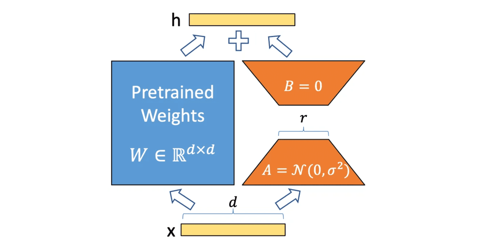

<!--
SPDX-FileCopyrightText: Copyright (c) 2026 NVIDIA CORPORATION & AFFILIATES. All rights reserved.
SPDX-License-Identifier: CC-BY-4.0
-->

# Llama 2 70B LoRA

:::{note}

CUDA Graph optimization for Llama 2 70B LoRA fine-tuning, based on NVIDIA's MLPerf Training v5.0 implementation (2025/06). This benchmark was introduced in MLPerf Training v4.0 (2024/06) and continues in v5.1 (2025/11). This example documents the v5.0 implementation, demonstrating per-layer CUDA graph capture with Megatron-Core's CudaGraphManager for parameter-efficient fine-tuning with LoRA adapters.
:::

## Overview

Llama 2 70B is Meta's 70-billion-parameter large language model released in July 2023, featuring a decoder-only transformer architecture with 80 layers, Grouped-Query Attention (GQA), and a 4,096-token context window. Fine-tuning such a large model on specific tasks traditionally requires updating all 70 billion parameters, which is computationally expensive and memory-intensive.

LoRA (Low-Rank Adaptation) is a parameter-efficient fine-tuning technique introduced by Hu et al. in 2021 ([LoRA: Low-Rank Adaptation of Large Language Models](https://arxiv.org/abs/2106.09685)). Instead of fine-tuning all 70 billion parameters (requiring ~140GB in mixed precision), LoRA freezes the original model weights and adds small trainable adapter matrices to each layer. This approach trains only ~55M parameters (0.08% of the base model), reducing memory footprint to ~80GB per GPU and enabling fine-tuning on consumer hardware.



*Figure: LoRA adapter architecture showing frozen pre-trained weights W and trainable low-rank matrices A and B*

The MLPerf Training benchmark uses LoRA to fine-tune Llama 2 70B on the GovReport dataset, a document summarization task that requires adapting the model's general language understanding to produce concise summaries of government reports.

## MLPerf Training Llama 2 70B LoRA

The NVIDIA MLPerf Training v5.0 implementation fine-tunes the 70B parameter Llama 2 model using LoRA adapters. For complete details on the benchmark design and selection process, see the [MLPerf blog post](https://mlcommons.org/2024/06/lora-fine-tuning-mlperf-training-v4-0/).

**Training Setup**:

- **Software stack**: NVIDIA NeMo + Megatron-Core + PyTorch Lightning + Transformer Engine + HuggingFace Transformers
- **Model architecture**: Llama 2 70B (80 transformer decoder layers, 8,192 hidden size, 64 attention heads, Grouped-Query Attention with 8 KV heads)
- **LoRA configuration**:
    - Rank (r): 16
    - Alpha (scaling factor): 32
    - Dropout: 0.1
    - Target modules: QKV projection and output projection in self-attention
    - Trainable parameters: ~55M (0.08% of base model)
- **Dataset**: GovReport from [SCROLLS benchmark](https://www.scrolls-benchmark.com/)
    - 19,466 training examples
    - 173 validation examples
    - Context length: 8,192 tokens
    - Task: Generate summaries from government research reports
- **Distributed training**: 3D parallelism combining tensor parallelism (TP), pipeline parallelism (PP), context parallelism (CP), and data parallelism (DP)
    - Example configuration (64 H100 GPUs): TP=4, PP=1, CP=2, DP=8, micro-batch size 1
- **Mixed precision**: BF16 with FP8 (Transformer Engine) for compute-intensive operations
- **Fixed sequence length**: 8,192 tokens (no sequence packing), enabling static graph capture

**Evaluation**:

- **Quality metric**: Cross-entropy loss on validation set (target: ≤ 0.925)
- **Evaluation frequency**: Every 384 sequences
- **Evaluation samples**: All 173 validation examples

**CUDA Graph Challenge**:

The main challenge is integrating CUDA graphs with FP8 training, which requires careful management of scaling factors as mutable graph state. Megatron-Core's `CudaGraphManager` addresses this through automatic FP8 state management. While this benchmark doesn't use pipeline parallelism (PP), `CudaGraphManager` also supports PP for more complex distributed setups.

## Integration Approach: Megatron-Core CudaGraphManager

The v5.0 implementation leverages **Megatron-Core's `CudaGraphManager`** for automatic just-in-time (JIT) CUDA graph capture. Each [`TransformerLayer`](https://github.com/NVIDIA/Megatron-LM/blob/25.04-alpha.rc1/megatron/core/transformer/transformer_layer.py#L237) instance is captured as a separate CUDA graph during the first training iterations, while embedding layers, loss computation, optimizer, and other components remain in eager mode. This per-layer graphing approach provides a robust solution for handling the complex execution patterns introduced by pipeline parallelism.

### How Per-Layer Graphing Works

Megatron-Core's `CudaGraphManager` uses a two-phase **record-then-capture** strategy:

1. **Recording phase** (warmup): Each layer records its execution sequence for all microbatches
2. **Capture phase**: Creates separate CUDA graphs per layer per microbatch per pass (forward/backward). For models with pipeline parallelism, this results in `layers × microbatches × 2` graphs. For this LoRA benchmark without PP, `CudaGraphManager` creates 80 layers × 2 passes = 160 graphs total.

This approach automatically preserves execution order, preventing memory corruption when graphs share memory pools. `CudaGraphManager` is best suited for models built on Megatron-LM's `TransformerLayer`, particularly when using pipeline parallelism (PP > 1) with interleaved microbatch execution.

For complete details on the two-phase approach and pipeline parallelism challenge, see [Transformer Engine and Megatron-LM CUDA Graphs - CudaGraphManager](../torch-cuda-graph/te-megatron-cuda-graphs.md#cudagraphmanager-per-layer-graphing).

**Implementation Details**:

- **Code**: [training_results_v5.0/NVIDIA/.../tyche_ngpu512_ngc25.04_nemo](https://github.com/mlcommons/training_results_v5.0/tree/main/NVIDIA/benchmarks/llama2_70b_lora/implementations/tyche_ngpu512_ngc25.04_nemo)
- **Framework versions**:
    - PyTorch: NGC 25.04 (`nvcr.io/nvdlfwea/pytorch:25.04-py3`)
    - NeMo: [25.04-alpha.rc1](https://github.com/NVIDIA/NeMo/tree/25.04-alpha.rc1)
    - Megatron-Core: [25.04-alpha.rc1](https://github.com/NVIDIA/Megatron-LM/tree/25.04-alpha.rc1)
    - Transformer Engine: [v2.2](https://github.com/NVIDIA/TransformerEngine/tree/v2.2) (included in PyTorch NGC container)
- **Configuration**: All submission configs set `MCORE_CUDA_GRAPH=1` (internal graphs enabled) and `LAYER_CUDA_GRAPH=0` (external graphs disabled)

:::{note} Alternative Implementation Available

The codebase also includes an external CUDA graph implementation using Transformer Engine's `make_graphed_callables()` (enabled via `LAYER_CUDA_GRAPH=1`), but this was **not used in the MLPerf v5.0 and later submissions**. The internal `CudaGraphManager` approach was preferred for its automatic handling of pipeline parallelism and simpler integration.
:::

### Capture Scope

The implementation graphs each **[`TransformerLayer`](https://github.com/NVIDIA/Megatron-LM/blob/25.04-alpha.rc1/megatron/core/transformer/transformer_layer.py#L237)** instance separately, creating **separate CUDA graphs per layer per microbatch** for both forward and backward passes. Each of the 80 Llama 2 decoder layers receives its own set of CUDA graphs.

**What gets captured** (per layer):

- Input LayerNorm
- Self-Attention:
    - QKV projection (linear layer + LoRA adapter)
    - Attention computation (QK matmul, softmax, attention-value matmul)
    - Output projection (linear layer + LoRA adapter)
- Bias-Dropout-Add after attention
- Pre-MLP LayerNorm
- MLP (SwiGLU activation with two linear layers)
- Bias-Dropout-Add after MLP
- All residual connections within the layer

**LoRA integration**: The rank-16 LoRA adapters (matrices A and B) are seamlessly integrated into the QKV and output projection layers within the captured graphs. During the forward pass, the adapter computation `BA·x` executes inside the graphed layer. During the backward pass, gradients flow through both the frozen base weights (which receive no updates) and the trainable LoRA weights (which accumulate gradients for the optimizer step).

**Components remaining in eager mode**:

- **Model structure**: Embedding layer (`LanguageModelEmbedding`), final LayerNorm, output projection layer
- **Training components**: Loss computation, optimizer step (Adam), gradient scaling/clipping, learning rate scheduling
- **LoRA-specific operations**: LoRA weight all-reduce across tensor parallel ranks (when using `a2a_experimental=True` for distributed LoRA)

**Rationale**: Transformer layers constitute the computational bottleneck, while LoRA adapters add minimal overhead. Capturing these layers significantly reduces kernel launch overhead for the dominant workload, while keeping complex control flow (loss computation, optimizer, LR scheduling) in eager mode for easier debugging and better compatibility.

**Deployment Scale**:

CUDA graphs are deployed across a wide range of hardware configurations:

- **H100 (DGX H100)**: 4-256 nodes (32-2,048 GPUs), 8 GPUs per node
    - Parallelism: TP=4, PP=1, CP=1 or CP=2
    - Largest configuration: 256 nodes × 8 GPUs = 2,048 GPUs
- **B200 (DGX B200)**: 8-96 nodes (64-768 GPUs), 8 GPUs per node
    - Parallelism: TP=1, PP=1, CP=8
    - Largest configuration: 96 nodes × 8 GPUs = 768 GPUs
- **GB200**: 9-144 nodes (36-576 GPUs), 4 GPUs per node
    - Parallelism: TP=1, PP=1, CP=4 or CP=8
    - Largest configuration: 144 nodes × 4 GPUs = 576 GPUs

**Example configuration** (64 H100 nodes, 512 GPUs):

- Parallelism: TP=4, PP=1, CP=2, DP=64 (calculated: 512 GPUs / (4 × 1 × 2) = 64)
- Micro-batch size per GPU: 1
- Global batch size: 64 (64 DP ranks × 1 micro-batch / 2 CP)
- Graph count: 80 transformer layers, each captured as separate graphs per microbatch

### CudaGraphManager Configuration

The implementation enables `CudaGraphManager` through model configuration in [train.py](https://github.com/mlcommons/training_results_v5.0/blob/main/NVIDIA/benchmarks/llama2_70b_lora/implementations/tyche_ngpu512_ngc25.04_nemo/train.py):

```python
llama2_config = llm.Llama2Config70B(
    # ... other config ...
    external_cuda_graph=cfg.model.external_cuda_graph,  # Set to False
    enable_cuda_graph=cfg.model.enable_cuda_graph,      # Set to True
)
```

All submission configs set the following environment variables (e.g., [config_GB200_128x4x1xtp1pp1cp8.sh#L16-L17](https://github.com/mlcommons/training_results_v5.0/blob/main/NVIDIA/benchmarks/llama2_70b_lora/implementations/tyche_ngpu512_ngc25.04_nemo/config_GB200_128x4x1xtp1pp1cp8.sh#L16-L17)):

```bash
export LAYER_CUDA_GRAPH=0       # External graphs disabled
export MCORE_CUDA_GRAPH=1       # Internal CudaGraphManager enabled (implicitly)
```

When `enable_cuda_graph=True`, Megatron-Core automatically orchestrates the entire capture process:

1. Creates a `CudaGraphManager` for each `TransformerLayer` during model initialization
2. Records the execution order during the first 3 warmup iterations (Phase 1)
3. Captures CUDA graphs in the recorded order (Phase 2)
4. Replays the captured graphs for all subsequent training iterations

For comprehensive implementation details, two-phase capture workflow, memory management strategies, and advanced features, see [Transformer Engine and Megatron-LM CUDA Graphs - CudaGraphManager](../torch-cuda-graph/te-megatron-cuda-graphs.md#cudagraphmanager-per-layer-graphing).

### MLPerf Warmup with Real Data

Unlike manual capture approaches that use synthetic data before timing starts, `CudaGraphManager` performs its warmup **during actual training with real data**. This design is acceptable for MLPerf because:

1. **Warmup is part of training**: The first 3 iterations (default `cuda_graph_warmup_steps`) run in eager mode and are included in MLPerf timing
2. **Automatic transition**: After warmup completes, the model automatically switches to graph replay without requiring explicit state resets
3. **FP8 statistics naturally stabilize**: FP8 scaling factors converge to appropriate values during the first few iterations with real data

**Additional Warmup for Large-Scale Stability**:

The implementation provides an **optional additional warmup** with synthetic data before actual training begins. This is configured via environment variables ([config_common.sh](https://github.com/mlcommons/training_results_v5.0/blob/main/NVIDIA/benchmarks/llama2_70b_lora/implementations/tyche_ngpu512_ngc25.04_nemo/config_common.sh)):

```bash
export WARMUP=True
export WARMUP_TRAIN_STEPS=5
export WARMUP_VALIDATION_STEPS=5
```

The warmup logic in [custom_callbacks.py](https://github.com/mlcommons/training_results_v5.0/blob/main/NVIDIA/benchmarks/llama2_70b_lora/implementations/tyche_ngpu512_ngc25.04_nemo/custom_callbacks.py):

```python
def warmup(self, trainer, pl_module):
    # Additional synthetic warmup (if enabled)
    if self.cfg.model.custom.warmup:
        run_training_warmup(
            trainer,
            self.cfg.model.custom.warmup_train_steps,
            self.cfg.model.custom.warmup_validation_steps,
        )

        # Reset FP8 statistics after warmup
        if self.cfg.model.fp8 and self.cfg.model.custom.reset_fp8_stats_after_warmup:
            reset_fp8_state(pl_module)
```

This additional synthetic warmup helps stabilize the optimizer and CUDA memory allocator before `CudaGraphManager` begins its own capture warmup with real data, potentially reducing graph capture failures at very large scales (hundreds to thousands of GPUs).

## Essential Modifications for CUDA Graph Compatibility

This section covers the essential changes required to make LoRA fine-tuning work correctly with Megatron-Core's `CudaGraphManager` per-layer CUDA graphs.

### 1. Transformer Engine RNG Tracker

**Problem**: PyTorch's default RNG uses CPU scalars for seed and offset, which cannot be captured in CUDA graphs. When operations like dropout use the global RNG during graph capture, the seed becomes a constant, causing identical dropout masks on every replay.

**Why this matters**: LoRA layers include dropout (0.1 dropout rate), and Transformer Engine provides a GPU-based RNG tracker specifically designed for tensor parallelism and CUDA graphs. It stores RNG state as device tensors that can be updated between graph replays.

**Solution**: Enable Transformer Engine's RNG tracker ([train.py](https://github.com/mlcommons/training_results_v5.0/blob/main/NVIDIA/benchmarks/llama2_70b_lora/implementations/tyche_ngpu512_ngc25.04_nemo/train.py)):

```python
strategy = nl.MegatronStrategy(
    # ... other config ...
    use_te_rng_tracker=cfg.model.use_te_rng_tracker,
)
```

**How it works**: Transformer Engine's RNG tracker maintains separate RNG states for different parallelism groups (TP, DP, CP). Each state is stored as a GPU tensor. Megatron's `CudaGraphManager` automatically registers these states with each CUDA graph during capture, allowing the RNG state to be updated between graph replays.

### 2. Disabling PyTorch NCCL Record Streams

**Problem**: PyTorch's default tensor lifetime management uses `record_stream()` to prevent premature deallocation of tensors used on multiple streams. During distributed training, NCCL operations launch communication kernels on dedicated side streams. Since these tensors are allocated on the computation stream but used on communication streams, PyTorch normally calls `record_stream()` to ensure buffers aren't recycled while communication is in progress.

**Why this matters for CUDA graphs**: When `record_stream()` is used, the caching allocator must check if recorded streams have completed before recycling memory. This check uses `cudaEventQuery()`, which is **forbidden during CUDA graph capture**. As a result, tensors with multi-stream usage cannot be recycled during graph capture, causing memory to accumulate and potentially leading to out-of-memory errors at scale.

PyTorch's NCCL process group provides an alternative mechanism: it can stash live references to tensors in `stashed_for_allocator_safety_` and only release them after user-facing streams are synced with communication streams via `work.wait()`. This achieves allocator safety without `record_stream()` calls or `cudaEventQuery()`, making it compatible with CUDA graph capture.

**Solution**: Disable PyTorch's `record_stream()` for NCCL operations ([config_common.sh](https://github.com/mlcommons/training_results_v5.0/blob/main/NVIDIA/benchmarks/llama2_70b_lora/implementations/tyche_ngpu512_ngc25.04_nemo/config_common.sh)):

```bash
export TORCH_NCCL_AVOID_RECORD_STREAMS=1
```

This environment variable instructs PyTorch's NCCL backend to avoid calling `record_stream()` on communication buffers, allowing them to be recycled more aggressively.

:::{note} PyTorch 2.8+ Default

In PyTorch 2.8+, this is the default behavior and the environment variable is deprecated. However, PyTorch NGC 25.04 (used in this implementation) still requires explicit configuration.
:::

**Trade-off**: Without `record_stream()`, the implementation relies on explicit stream synchronization to ensure buffer lifetime correctness. Megatron-LM's communication patterns are designed to handle this correctly.

### 3. Stream Management

**Problem**: CUDA graph capture requires running on a non-blocking side stream to avoid implicit synchronization with the default stream.

**Why this matters**: If capture happens on the default stream, operations may create implicit synchronization points that prevent proper graph capture.

**Solution**: `CudaGraphManager` automatically handles stream management during initialization ([Megatron-LM cuda_graphs.py#L804-807](https://github.com/NVIDIA/Megatron-LM/blob/25.04-alpha.rc1/megatron/core/transformer/cuda_graphs.py#L804-L807)):

```python
# In CudaGraphManager.__init__():
# Cudagraph stream capture requires no operations on the default stream prior to the
# capture, so change to a side stream.
self.stream = torch.cuda.current_stream()
torch.cuda.set_stream(torch.cuda.Stream())
```

The implementation also sets a side stream after model initialization ([custom_llama.py](https://github.com/mlcommons/training_results_v5.0/blob/main/NVIDIA/benchmarks/llama2_70b_lora/implementations/tyche_ngpu512_ngc25.04_nemo/custom_llama.py#L69-70)):

```python
def configure_model(self):
    import transformer_engine.pytorch as te
    with torch.no_grad(), te.fp8_model_init():
        super().configure_model()

    # Switch to side stream for training
    s = torch.cuda.Stream()
    torch.cuda.set_stream(s)
```

**Effect**: All subsequent training operations (including CUDA graph capture and replay) execute on the side stream, preventing interference from default stream operations.

### 4. Automatic Buffer Sharing

**What it is**: `CudaGraphManager` automatically enables input/output buffer sharing for decoder-only transformer layers, reusing the previous layer's output buffer as the next layer's input buffer.

**Why this matters**: Each CUDA graph requires static input and output buffers allocated upfront. Without buffer sharing, every layer needs its own set of buffers, consuming significant memory. Buffer sharing dramatically reduces memory consumption by chaining layers together.

**How it's enabled**: For Llama 2 70B LoRA, buffer sharing is automatically activated because the model uses `TransformerLayer` without cross-attention (decoder-only architecture). The `CudaGraphManager` detects this at initialization ([cuda_graphs.py#L395-400](https://github.com/NVIDIA/Megatron-LM/blob/25.04-alpha.rc1/megatron/core/transformer/cuda_graphs.py#L395-L400)):

```python
self.reuse_input_output_buffer = False
if (
    isinstance(base_module, TransformerLayer)
    and isinstance(base_module.cross_attention, IdentityOp)
) or isinstance(base_module, MambaLayer):
    self.reuse_input_output_buffer = True
```

**Configuration**: No manual configuration needed—this optimization is automatic for decoder-only models.

**Benefit**: Significantly reduces memory consumption during graph capture, especially important at large scale with 80 layers.

For more details on buffer sharing and memory pool strategies, see [Transformer Engine and Megatron-LM CUDA Graphs - Advanced Options](../torch-cuda-graph/te-megatron-cuda-graphs.md#advanced-options).

### 5. FP8 Training Support

**Problem**: FP8 training requires global state updates (amax reduction, scale factor computation) that must happen once per training iteration across all layers. In normal eager execution, Transformer Engine calls `reduce_and_update_fp8_tensors()` at the end of the `fp8_autocast` context to perform an all-reduce of amax values and update scaling factors. However, with per-layer graphing, this would capture the all-reduce inside each layer's graph, causing it to execute once per layer instead of once per iteration.

**Solution**: `CudaGraphManager` uses `fp8_autocast(..., _graph=True)` to skip the automatic all-reduce during graph capture and replay, then explicitly triggers it once after all backward graphs complete.

**How it works**:

**a) During capture/replay** ([cuda_graphs.py#L412-419](https://github.com/NVIDIA/Megatron-LM/blob/25.04-alpha.rc2/megatron/core/transformer/cuda_graphs.py#L412-L419)):

```python
def get_fp8_context(self):
    if self.fp8_enabled:
        return fp8_autocast(
            enabled=True, calibrating=False, fp8_recipe=self.fp8_recipe, _graph=True
        )
    return nullcontext()
```

The `_graph=True` flag tells Transformer Engine to skip `reduce_and_update_fp8_tensors()` when exiting the autocast context ([TE fp8.py#L445](https://github.com/NVIDIA/TransformerEngine/blob/v2.2/transformer_engine/pytorch/fp8.py#L445)):

```python
if enabled and cls.FP8_AUTOCAST_DEPTH == 0 and not _graph and torch.is_grad_enabled():
    cls.reduce_and_update_fp8_tensors(forward=True)  # Skipped when _graph=True
```

**b) After backward graphs complete** ([cuda_graphs.py#L329-331](https://github.com/NVIDIA/Megatron-LM/blob/25.04-alpha.rc2/megatron/core/transformer/cuda_graphs.py#L329-L331)):

```python
if runner.fp8_enabled and ctx.is_first_fp8_module:
    FP8GlobalStateManager.reduce_and_update_fp8_tensors(forward=False)
```

This explicitly calls the all-reduce and scale update once per iteration in eager mode, maintaining correct FP8 semantics.

**c) State preservation during capture** ([cuda_graphs.py#L433-439, L501-502](https://github.com/NVIDIA/Megatron-LM/blob/25.04-alpha.rc2/megatron/core/transformer/cuda_graphs.py#L433-L439)):

```python
if self.fp8_enabled:
    saved_fp8_tensors = save_fp8_tensors([self.base_module], self.fp8_recipe)
# ... capture graph ...
if self.fp8_enabled:
    restore_fp8_tensors([self.base_module], saved_fp8_tensors)
```

This prevents warmup iterations from corrupting FP8 scaling factors with synthetic data.

**Configuration** ([config_common.sh#L20-25](https://github.com/mlcommons/training_results_v5.0/blob/main/NVIDIA/benchmarks/llama2_70b_lora/implementations/tyche_ngpu512_ngc25.04_nemo/config_common.sh#L20-L25)):

```bash
export FP8=True
export FP8_AMAX_ALGO=max
export FP8_REDUCE_AMAX=True
export FP8_AMAX_HISTORY=4
export FP8_DPA=1  # FP8 dot product attention
```

**Effect**: Each layer's graph contains FP8 quantization and compute operations, while the global amax reduction and scale updates execute once per iteration in eager mode, achieving both FP8's performance benefits and CUDA graphs' overhead reduction.

## Performance Impact

Per-layer CUDA graph optimization delivers significant speedups for Llama 2 70B LoRA fine-tuning, with larger improvements at scale as kernel launch overhead becomes more pronounced.

**Measured Speedup (vs. no CUDA graphs)**:

| Hardware | Small Scale | Large Scale |
|----------|-------------|-------------|
| **B200 (DGX B200)** | 1.2× (64 GPUs) | 2.7× (768 GPUs) |
| **GB200** | 2.4× (36 GPUs) | 6.6× (576 GPUs) |

**Why it works**:

- **Reduced kernel launch overhead**: Each transformer layer's compute kernels (attention, MLP, LayerNorm, LoRA adapters) are submitted as a single graph instead of individual kernel launches
- **Eliminates CPU jitter**: Graph replay removes timing variability from Python interpreter, CPU scheduling, and framework overhead
- **Scaling benefits**: Launch overhead and jitter reduction compound across distributed training—larger deployments see greater speedups

**Memory overhead**: Minimal—automatic buffer sharing between layers (see [Automatic Buffer Sharing](#4-automatic-buffer-sharing)) means only graph metadata is stored, not duplicate I/O buffers.

## Key Lessons

The Llama 2 70B LoRA CUDA graph implementation demonstrates practical deployment of per-layer graph optimization for parameter-efficient fine-tuning:

1. **Automatic per-layer graphing simplifies adoption**: Megatron-Core's `CudaGraphManager` handles capture, replay, memory management, and FP8 integration automatically. Simply set `enable_cuda_graph=True` and training proceeds with graphs after warmup.

2. **Two-phase capture solves pipeline parallelism complexity**: Phase 1 records layer execution order during warmup, Phase 2 captures graphs in that order. This automatically handles interleaved microbatch execution with PP > 1, preventing memory pool corruption.

3. **LoRA adapters graph seamlessly**: Low-rank adapter computations integrate into transformer layer graphs without special handling, benefiting from the same kernel launch overhead and jitter reduction as base model layers.

4. **FP8 training requires coordinated state management**: `CudaGraphManager` uses `fp8_autocast(..., _graph=True)` to skip per-layer amax reduction during graph capture/replay, then explicitly triggers it once after all backward graphs complete, maintaining correct FP8 semantics.

5. **Essential modifications for compatibility**:

    - **Transformer Engine RNG tracker** (`use_te_rng_tracker=True`): GPU-based RNG state for dropout and stochastic operations
    - **NCCL avoid record streams** (`TORCH_NCCL_AVOID_RECORD_STREAMS=1`): Prevents memory consumption issues during capture
    - **Side stream isolation**: Switch to side stream after model initialization to avoid default stream synchronization

6. **Automatic buffer sharing minimizes memory overhead**: `CudaGraphManager` automatically reuses output buffers as input buffers between layers for decoder-only models, making memory overhead minimal (only graph metadata, not duplicate I/O buffers).

7. **Dramatic speedups at scale**: Per-layer graphing achieves 1.2×-2.7× speedup on B200 and 2.4×-6.6× on GB200, with larger improvements at scale as kernel launch overhead and CPU jitter become more significant.

## References

**MLPerf Training Resources**:

- [MLPerf Training v4.0 Announcement](https://mlcommons.org/2024/06/mlperf-training-v4-benchmark-results/) - Introduction of Llama 2 70B LoRA benchmark
- [LoRA Fine-Tuning Technical Blog](https://mlcommons.org/2024/06/lora-fine-tuning-mlperf-training-v4-0/) - Algorithm selection and design rationale
- [MLPerf Reference Implementation](https://github.com/mlcommons/training/blob/95f90e857ade5392f83f54393cdccb55d12ac67f/llama2_70b_lora/README.md) - Official reference code
- [NVIDIA v5.0 Implementation](https://github.com/mlcommons/training_results_v5.0/tree/main/NVIDIA/benchmarks/llama2_70b_lora/implementations/tyche_ngpu512_ngc25.04_nemo) - Production implementation with CudaGraphManager

**Framework Documentation**:

- [Megatron-LM (25.04-alpha.rc1)](https://github.com/NVIDIA/Megatron-LM/tree/25.04-alpha.rc1) - Core framework with CudaGraphManager
- [NeMo Framework (25.04-alpha.rc1)](https://github.com/NVIDIA/NeMo/tree/25.04-alpha.rc1) - High-level training toolkit
- [Transformer Engine (v2.2)](https://github.com/NVIDIA/TransformerEngine/tree/v2.2) - FP8 training and RNG tracker
- [LoRA Paper](https://arxiv.org/abs/2106.09685) - Original Low-Rank Adaptation technique

**Related Documentation**:

- [Transformer Engine and Megatron-LM CUDA Graphs](../torch-cuda-graph/te-megatron-cuda-graphs.md) - Complete CudaGraphManager implementation details
- [Llama 3.1 405B](llama-31-405b.md) - Per-layer and full-iteration graphing examples
- [Troubleshooting: Replay Order Mismatch](../troubleshooting/numerical-errors.md#replay-order-mismatch) - Memory pool corruption issue

## What's Next?

**Explore more CUDA graph examples**:

- **[Llama 3.1 405B](llama-31-405b.md)** - Large-scale pre-training with per-layer and full-iteration graphing approaches
- **[Stable Diffusion v2](stable-diffusion-v2.md)** - Full-iteration graphing for image generation
- **[RNN Transducer](rnnt.md)** - Speech recognition with dynamic control flow

**Continue learning**:

- **[Transformer Engine and Megatron-LM CUDA Graphs Guide](../torch-cuda-graph/te-megatron-cuda-graphs.md)** - Deep dive into CudaGraphManager internals
- **[Troubleshooting](../troubleshooting/introduction.md)** - Debug common capture and replay issues
